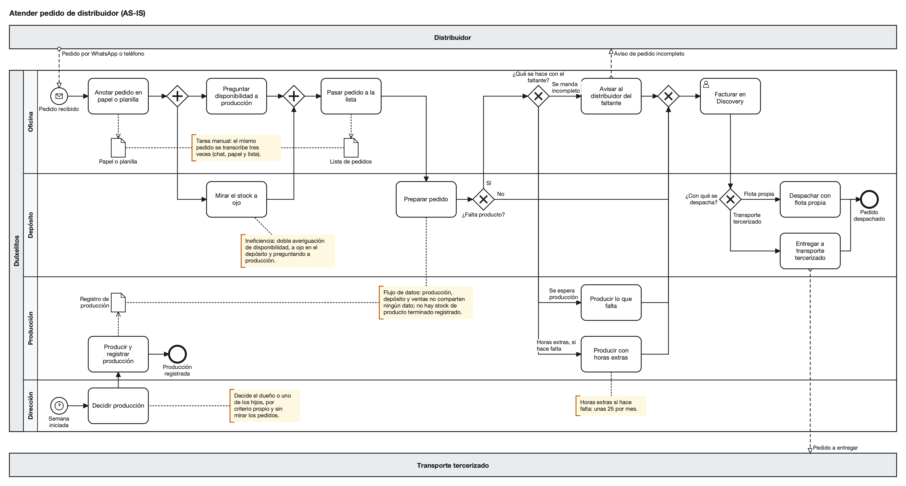

# Proceso actual y alternativas de solución

Esta sección describe cómo se atiende hoy un pedido de distribuidor, qué encuentran en él las tres lentes de la Clase 7 y qué alternativas hay, incluida la de no hacer nada. Parte de la corrección a la Parte 1 de la sección 1: el stock de producto terminado no se registra y los recortes vienen de la mezcla y del momento de producción, no de la capacidad total. El proceso, los volúmenes y los datos salen del relevamiento con nuestro compañero que trabaja en Dulxelitos; el RECI, las lentes y los puntajes son nuestro juicio, y lo que no sabemos queda como "dato pendiente".

## Matriz de descubrimiento

| Campo | Contenido |
|---|---|
| **Nombre** | Atender pedido de distribuidor |
| **Empieza cuando** | Llega un pedido del distribuidor por WhatsApp o por teléfono |
| **Termina (camino feliz)** | El pedido queda facturado en Discovery y despachado |
| **Áreas involucradas** | Oficina, depósito, producción y dirección (el dueño y los hijos) |
| **Actores externos** | El distribuidor, que inicia el proceso y recibe el resultado, y el transporte tercerizado, cuando no se despacha con flota propia |
| **Volumen y periodicidad** | ~25 pedidos por día, ~125 por semana (25 por 5 días hábiles). La demanda es pareja todo el año |
| **Camino alternativo frecuente** | Falta producto: en la semana que registramos, 30 de ~125 pedidos salieron recortados o demorados (~24 %) |
| **Fuera de los límites** | Insumos y packaging, y la visibilidad de stock para el distribuidor (sección 1) |

Mapeamos el camino feliz, pero dibujamos el faltante completo porque pasa todas las semanas. La decisión de qué producir corre aparte; la dibujamos igual porque su desconexión de los pedidos es parte del problema.

## SIPOC

Tiene seis pasos: cinco del camino feliz y el cuarto, alternativo, que en Dulxelitos ocurre todas las semanas.

| # | Proveedor | Entrada | Proceso | Salida | Cliente |
|---|---|---|---|---|---|
| 1 | Distribuidor (externo) | Pedido por WhatsApp o teléfono: productos, cantidades, zona | Recibir pedido | Pedido anotado en papel o planilla | Oficina (paso 2) |
| 2 | Depósito y Producción | Pedido anotado; lo que se ve a ojo en el depósito; lo que contesta producción | Verificar disponibilidad | Disponibilidad conocida y pedido pasado a la lista | Depósito (paso 3) |
| 3 | Oficina (la lista) y Producción (producto terminado) | Lista de pedidos y producto terminado | Preparar pedido | Pedido armado, completo o con faltante | Oficina (pasos 4 y 5) |
| 4 | Depósito y Producción | Faltante detectado al armar | Resolver faltante (solo si falta producto) | Aviso al distribuidor, o producto producido con o sin horas extras | Distribuidor y Oficina |
| 5 | Depósito | Pedido armado o ya completado | Facturar pedido | Pedido facturado en Discovery | Distribuidor y Depósito (paso 6) |
| 6 | Oficina | Pedido facturado | Despachar pedido | Pedido despachado | Distribuidor y transporte tercerizado (externo, si se terceriza) |

En el paso 2 la información viene de personas y no de registros, y ningún paso lee ni actualiza un stock registrado.

## RECI

**R** es el responsable, el que responde por el resultado (uno solo por actividad); **E** es el ejecutor; **C**, el consultado; **I**, el informado. En una pyme quien ejecuta suele ser quien responde, por eso todas las filas son R/E. Las columnas son las lanes del diagrama más dos actores externos, que nunca son R y solo aparecen como informados. Los nombres son los del diagrama.

| Actividad | Oficina | Depósito | Producción | Dirección | Distribuidor (externo) | Transporte tercerizado (externo) |
|---|---|---|---|---|---|---|
| Anotar pedido en papel o planilla | R/E | – | – | – | – | – |
| Preguntar disponibilidad a producción | R/E | – | C | – | – | – |
| Mirar el stock a ojo | I | R/E | – | – | – | – |
| Pasar pedido a la lista | R/E | I | – | – | – | – |
| Preparar pedido | I | R/E | – | – | – | – |
| Avisar al distribuidor del faltante | R/E | C | – | – | I | – |
| Producir lo que falta | I | I | R/E | C* | – | – |
| Producir con horas extras | I | I | R/E | C* | – | – |
| Facturar en Discovery | R/E | C | – | – | I | – |
| Despachar con flota propia | I | R/E | – | – | I | – |
| Entregar a transporte tercerizado | I | R/E | – | – | I | I |
| Decidir producción | – | – | I | R/E | – | – |
| Producir lo decidido | – | – | R/E | I | – | – |
| Registrar producción de la semana | – | – | R/E | – | – | – |

\* Supuesto nuestro, a confirmar: como la producción la deciden el dueño o los hijos, leemos que producir de más o con horas extras se consulta con Dirección.

- **Quién responde "Preguntar disponibilidad a producción".** Oficina la ejecuta y responde por ella; la respuesta la da Producción, que figura como consultada (C). Es el punto en que Oficina consulta a producción antes de pasar el pedido a la lista, y es una pregunta a una persona, no a un registro.
- **"Decidir producción" no tiene a nadie consultado.** Ni Oficina ni Depósito, que son los que conocen los pedidos.
- **El faltante no tiene un dueño relevado.** La compuerta "¿Qué se hace con el faltante?" no es una actividad: alguien decide entre mandar incompleto, esperar producción o hacer horas extras. El diagrama la dibuja en Oficina porque ahí se avisa al distribuidor, pero no relevamos quién decide ni quién autoriza las horas extras: [dato pendiente: quién decide qué se hace con el faltante y quién autoriza las horas extras].
- **Rol y persona no coinciden en Dirección.** Hay una sola R, pero decide el dueño o uno de los hijos, según el caso, y no está definido cuál responde.

## Diagrama AS-IS

**Cómo se lee.** El pedido nace en el mensaje del distribuidor. Oficina lo anota y, en paralelo, pregunta a producción mientras depósito mira el stock a ojo; con las dos respuestas pasa el pedido a la lista y Depósito lo prepara. Si no falta nada, se factura en Discovery y se despacha con flota propia o con transporte tercerizado.

La pregunta "¿Falta producto?" viene después de preparar el pedido: la averiguación previa no alcanza para saberlo. Hay tres salidas (mandar incompleto avisando, esperar producción o producir con horas extras) que vuelven a juntarse antes de facturar. La compuerta que elige entre ellas está dibujada en Oficina porque ahí se avisa al distribuidor; quién decide y quién autoriza las horas extras no lo relevamos (ver RECI).

En los carriles de abajo, cada semana el dueño o uno de los hijos decide qué producir por criterio propio, sin mirar los pedidos, y Producción produce y registra la semana una sola vez (el 20 % de los días hábiles) sin cruzar el registro con las ventas. La producción semanal solo se cruza con el pedido cuando falta producto, y recién al armarlo. El diagrama no tiene ningún paso de consultar o reservar un stock registrado: es el mapa de un proceso que acepta pedidos sin saber qué hay y produce sin saber qué se pidió.

| Aspecto | Hoy |
|---|---|
| **Actores y pasos** | Las 4 lanes y los 2 externos; 14 actividades: 11 del pedido y 3 de producción, que corre aparte |
| **Entradas** | Pedido por WhatsApp o teléfono; lo que se ve a ojo y lo que contesta producción; la decisión de producción del dueño o los hijos |
| **Salidas** | Pedido facturado y despachado; aviso de pedido incompleto; registro semanal de producción |
| **Herramientas** | WhatsApp y teléfono; papel o planilla; una lista de pedidos; Discovery, solo para facturar; el control propio de producción, que se carga una vez por semana |
| **Dolores** | Pedidos recortados o demorados todas las semanas; faltantes que aparecen al armar; horas extras; producción que no mira los pedidos |
| **Costos** | ~25 horas extras por mes, en parte para completar pedidos. En pesos: [dato pendiente: costo por hora extra]. Margen perdido en pedidos recortados: [dato pendiente: margen o valor promedio de un pedido recortado] |
| **Indicadores y línea de base** | Pedidos completos y a tiempo: 76 % (cuenta nuestra sobre una semana). Días con producción cargada: 20 %. Horas extras: ~25 por mes. Exactitud de stock: no existe porque no hay stock registrado; sale del primer conteo [dato pendiente: exactitud de stock en el conteo inicial] |
| **Lo que no es el problema** | El armado del pedido: según nuestro compañero es rápido y no se mide, así que no es la restricción |

**Dependencias informales.** El proceso funciona porque la gente se acuerda de cosas que no están escritas:

- **WhatsApp, teléfono y papel.** El pedido original vive en el chat o en la llamada; lo que queda en el papel o planilla de quien atiende y en la lista son copias a mano que nadie más ve.
- **Preguntar a producción y mirar a ojo.** La disponibilidad depende de lo que sepa y conteste una persona, y de la vista de quien está en el depósito. No queda registro.
- **El criterio del dueño y los hijos.** Qué producir se decide por experiencia, sin pedidos ni stock a la vista.
- **El faltante y las horas extras.** Funciona de hecho; cómo se decide no está relevado (ver RECI).
- **El control propio de producción.** Se carga una vez por semana y no está vinculado a ventas: lo que sabe producción no le llega al resto.

## Tres lentes

**Lente 1: ineficiencias.** La disponibilidad se averigua dos veces, preguntando a producción y mirando a ojo, porque ninguna alcanza sola; además, cuando falta producto el pedido espera producción u horas extras antes de facturarse. No se arregla con un workflow: la intervención es un rediseño, reservar el stock contra pedidos antes de confirmar.

**Lente 2: tareas manuales.** El mismo pedido se transcribe tres veces: queda en el chat, se copia al papel o planilla y se vuelve a copiar a la lista, y cada copia a mano es un punto donde se puede equivocar un producto o una cantidad. La intervención es cargar el pedido una sola vez y que de ahí salgan la reserva y la lista de armado: un único registro, no el mismo papel en pantalla.

**Lente 3: flujo de datos.** Producción, depósito y ventas no comparten ningún dato: no hay stock de producto terminado registrado y lo producido se carga una vez por semana en un control propio que no se cruza con los pedidos. Es el silo más grande. La intervención es un registro de stock cargado todos los días, con un solo criterio de stock disponible: stock físico menos lo reservado por pedidos confirmados sin facturar.

**Cuál va primero.** Las tres lentes no dan tres proyectos sino una sola causa vista desde tres lados, así que no ordenamos iniciativas con impacto-esfuerzo ni con RICE (que, como dijo la clase, no decide: fuerza la discusión). Lo que ordenamos son los pasos de una iniciativa: primero un quick win, la planilla del piloto, que cuesta poco y enseña mucho; después la inversión de impacto alto, el stock en Discovery.

**La pregunta del proceso balde.** La clase del 05-10 pidió, antes de mejorar, preguntar si el proceso aporta valor al cliente final o solo contiene un error anterior: la paradoja de la gotera, donde se pone un balde debajo y nadie arregla la gotera. "Atender pedido de distribuidor" sí aporta valor, porque empieza y termina en el distribuidor, pero tiene baldes adentro. La gotera es doble: no se registra el stock y se produce sin mirar los pedidos. Los baldes son la doble averiguación, el aviso de faltante y las horas extras para completar pedidos. Acelerar el aviso por WhatsApp o armar un tablero de horas extras sería una solución balde. Una parte de las horas extras no es balde: tapa la saturación de la planta, que es capacidad y está fuera de alcance.

## Alternativas

El enunciado pide una mejora incremental y de bajo costo (A), una intermedia que configure una herramienta existente (B) y una integral solo si el caso la justifica (C). No la justifica: queda como evaluada y descartada.

**Do Nothing: seguir igual.**

- **Costo.** No hay inversión; el costo es seguir igual: las ~25 horas extras por mes (en parte), los pedidos recortados o demorados todas las semanas y un margen perdido que hoy no podemos poner en pesos (ver Costos arriba). La Parte 1 dijo que el costo de no actuar "no está bajo, está sin observar"; ahora sabemos por qué: ni el stock ni los recortes se registraban.
- **Resuelve y no resuelve.** No resuelve nada, y la planta sigue dependiendo de la memoria del dueño, de los hijos y de quien mira a ojo.

**A. Planilla compartida (incremental).**

- **Qué es.** Una planilla compartida de stock de producto terminado: Producción carga lo producido al cierre de cada turno, Oficina reserva por pedido confirmado y hay una reunión diaria corta entre ventas y producción (~10 minutos). Mismo criterio que B: el stock disponible es el stock físico menos lo reservado por pedidos confirmados sin facturar. Se prueba como piloto de 2 semanas con papas fritas, el producto que más falta.
- **Costo.** Casi cero en plata: la planilla y el tiempo de carga, de reunión y del conteo inicial.
- **Qué resuelve.** Hace visible un stock que hoy no existe y permite probar con poco riesgo que producción y oficina sostienen la carga diaria (supuesto 2 de la sección 4) y que planificar contra pedidos baja los recortes (supuesto 1).
- **Qué no resuelve.** No se conecta con Discovery: al facturar se baja el físico y se descuenta la reserva a mano, y el pedido se carga dos veces. Vive en un archivo suelto que depende de quien lo carga, escala mal a todos los productos y no cambia por sí sola cómo se decide qué producir.

**B. Stock de Discovery (intermedia, recomendada).**

- **Qué es.** Activar el módulo de stock de Discovery, que según nuestro compañero está dentro de la licencia, permite pedidos y reserva, y la empresa no usó. Conteo físico inicial y activación línea de producto por línea de producto, con el mismo criterio de stock disponible y la misma rutina que A, más un responsable de carga por turno con suplente y conteo cíclico semanal.
- **Costo.** Sin licencia nueva. Cuesta el conteo inicial, la capacitación, el tiempo de carga y [dato pendiente: costo de activar el módulo de stock, si el proveedor cobra soporte o capacitación]. Lo que se paga una sola vez se reparte en los 6 meses del plazo.
- **Qué resuelve.** Un solo registro de stock en la herramienta donde ya se factura, con el pedido cargado una vez y la reserva consumida por la factura (si el módulo funciona como esperamos: supuesto 3). Ataca la causa común de las tres lentes.
- **Qué no resuelve.** Que la producción se decida mirando pedidos (es un cambio de criterio de Dirección, no de herramienta), la saturación de la planta, los insumos y packaging, ni la visibilidad para el distribuidor, que queda para "later". Y tiene un riesgo propio: la Parte 1 describió a Discovery como desactualizado y con errores, y la versión y el soporte incluidos son [dato pendiente: versión de Discovery y soporte incluido].

**C. SaaS de gestión (integral, evaluada y descartada).**

- **Qué es y costo.** Un sistema de gestión en la nube para pedidos y stock, que conviviera con Discovery o lo reemplazara. Cuota mensual nueva, migración, capacitación y, si Discovery sigue para facturar, su costo también. No pedimos cotizaciones: la evaluamos como categoría, y los otros motivos alcanzan para descartarla.
- **Qué resuelve.** En teoría, pedido y stock en un solo lugar y mejor escala.
- **Qué no resuelve.** La disciplina de carga: si el equipo no sostiene una carga diaria en una planilla simple, tampoco la sostendrá en un sistema más grande. Según la Parte 1, Discovery no se integra con otros sistemas, así que el SaaS quedaría al lado con carga manual en los dos. Reemplazar Discovery está fuera de alcance (sección 1).

## Matriz multicriterio

Usa los diez criterios del enunciado y compara cada alternativa como **solución para los 6 meses y para todos los productos**, no como piloto. La escala va de 1 a 5, y **5 siempre es lo más favorable para la empresa**: en costo, tiempo y complejidad, 5 es lo más barato, rápido y simple. Los puntajes son nuestro juicio sobre el relevamiento y los supuestos de la sección 4; ninguno sale de una medición.

| Criterio (qué miramos) | Do Nothing | A. Planilla compartida | B. Stock de Discovery | C. SaaS |
|---|---|---|---|---|
| **1. Alineación al negocio** (¿ataca la causa: pedidos aceptados sin saber qué hay y producción sin mirar pedidos?) | **1.** No toca la causa: los recortes siguen cada semana | **3.** Registra y reserva, pero al facturar se baja el físico y se descuenta la reserva a mano, y no cambia sola cómo se decide producir | **4.** Registra, reserva y factura en el mismo lugar. No llega a 5: producir mirando pedidos es un cambio de criterio, no de herramienta | **3.** Cubre pedido y stock, pero no la disciplina de carga ni la decisión de producir, y suma un sistema al lado de Discovery |
| **2. Costo** (inversión y gasto recurrente; 5 es lo más barato) | **5.** No hay inversión; el costo de seguir igual se mide aparte | **5.** Casi cero: la planilla y el tiempo de carga y de conteo | **4.** Sin licencia nueva. Cuesta conteo, capacitación y [dato pendiente: costo de activar el módulo] | **2.** Cuota nueva, migración y capacitación, y se sigue pagando Discovery para facturar |
| **3. Viabilidad operativa** (¿se puede hacer con una planta saturada, sin frenarla?) | **3.** Se puede y es lo que se hace hoy, pero sostenido con horas extras | **3.** Es chica con un producto. Con todos, la carga doble (planilla y Discovery) pesa sobre una planta al límite | **3.** Una sola carga, pero exige carga diaria y reserva con la gente que hay, sobre un módulo que nadie usó en Dulxelitos | **2.** Migrar datos y capacitar a tres áreas con la planta al límite |
| **4. Tiempo** (rapidez hasta el primer efecto) | **1.** No hay efecto nunca | **5.** Se arma sin proveedor ni instalación; el piloto dura 2 semanas | **3.** Hay que activar con el proveedor y hacer el conteo inicial, línea por línea: [dato pendiente: plazo de activación del módulo] | **2.** Elegir producto, contratar, migrar y capacitar antes del primer efecto |
| **5. Adopción** (¿lo usan quienes tienen que usarlo?) | **5.** No le pide nada a nadie. Por eso no hay resistencia, y tampoco mejora | **3.** El formato es familiar, pero es trabajo nuevo para producción y oficina y se carga dos veces | **3.** La misma carga diaria, una sola vez, en una herramienta que la Parte 1 describió vieja y que nadie usó para esto | **2.** Herramienta y pantallas nuevas, y doble carga con Discovery |
| **6. Complejidad** (5 es lo más simple) | **5.** Ninguna | **3.** Simple de armar, pero reservar y descontar a mano se presta a errores cuando suben los productos | **3.** Hay que configurar pedido, reserva y consumo por factura. Depende de la versión: [dato pendiente: versión de Discovery] | **1.** Dos sistemas que no se integran, más una migración |
| **7. Capacidad interna** (¿lo puede hacer la gente de la empresa?) | **5.** No hace falta nada | **4.** Lo arma el responsable de sistemas, sin proveedor. Baja porque se suma a un rol cuyo tiempo disponible no conocemos | **3.** Depende de Buenos Aires Software para activar y configurar, y del tiempo del responsable de sistemas | **2.** Proveedor nuevo y dos sistemas para sostener con el equipo de hoy |
| **8. Integración** (¿conecta pedido, stock y facturación?) | **1.** Nada se conecta | **2.** La planilla no habla con Discovery: al facturar se baja el físico y se descuenta la reserva a mano | **4.** Pedido, reserva, stock y factura en Discovery. Falta confirmar que la factura consume la reserva (supuesto 3) | **2.** Según la Parte 1, Discovery no se integra con otros sistemas: carga manual entre los dos |
| **9. Flujo de caja** (cuánto sale y cuándo; 5 es poco y sin cuotas fijas nuevas) | **3.** No sale plata nueva, pero siguen saliendo las horas extras y se pierde margen en los pedidos recortados | **5.** Casi nada, y se puede cortar sin perder inversión | **4.** Sin cuota nueva. El gasto es puntual y el dueño acepta invertir si se demuestra el retorno | **2.** Cuota fija mensual en una empresa que cobra de contado, a ~30 días o con cheques diferidos (Parte 1) |
| **10. Continuidad operativa** (¿protege ventas y producción durante y después del cambio?) | **2.** Depende de la memoria del dueño, los hijos y quien mira a ojo; si faltan, no hay registro | **3.** No corta nada y se revierte, pero es un archivo suelto que depende de quien lo carga | **4.** Una sola fuente en la herramienta de facturación, con carga por turno y suplente. Riesgo: Discovery está desactualizado y con errores (Parte 1) | **2.** Suma un proveedor más para algo de uso diario y una migración encima de la operación |
| **Total (suma simple, máximo 50)** | **31** | **36** | **35** | **20** |

**Cómo leer la matriz.** C se descarta: tiene la suma más baja y no es la mejor en ningún criterio. Do Nothing suma 31 porque la suma premia lo fácil; se descarta por alineación 1 e integración 1, es decir, porque no resuelve el problema. A y B quedan casi empatadas, 36 contra 35, y un punto entre puntajes de juicio no es una diferencia.

Probamos pesos distintos como ejercicio de sensibilidad, y hay que leerlo con cuidado: lo hicimos después de ver el empate y armamos los pesos alrededor de los criterios en que cada una es fuerte, así que no prueba nada. Si alineación, integración y continuidad operativa pesan más de ~1,25 veces que los demás, B supera a A (con ese peso empatan en 38); dar más peso a costo, tiempo y flujo de caja solo agranda la ventaja de A. El empate es fino hacia los dos lados y la matriz no decide.

Decide el argumento cualitativo. Las notas bajas de A son estructurales: integración 2, alineación 3 y continuidad 3 salen de que la planilla vive aparte de Discovery, y no mejoran con la práctica. Las notas medias de B son incógnitas: viabilidad, tiempo, adopción, complejidad y capacidad interna valen 3 porque nadie usó ese módulo en Dulxelitos, y pueden subir o bajar cuando se sepa. Además el dueño aceptó invertir más si se demuestra el retorno, así que el costo pesa menos mientras ese retorno se demuestre. Por eso A va primero, como paso 1 y MVP: las incógnitas de B las despejan el piloto con A y la activación por línea de producto, y B es el destino.

## Recomendación

**Recomendamos B, el stock de Discovery, con A, la planilla compartida, como piloto de 2 semanas sobre papas fritas.** B es la solución del proceso nuevo; A es el experimento que la prueba antes de gastar.

**Por qué en ese orden.** Si el equipo no sostiene la carga diaria en una planilla simple, tampoco la va a sostener en Discovery, y habríamos pagado una herramienta por un problema de disciplina. Y digitalizar sin rediseñar no acorta el tiempo de ciclo (la firma digital de planos de la clase del 19-10): cargar stock sin que la producción se decida mirando pedidos no baja los recortes (supuesto 5), por eso va con el rediseño de la sección 3. El piloto con A prueba la carga diaria y si planificar contra pedidos baja los recortes (supuestos 1 y 2); no despeja el supuesto 3 (que Discovery reserve y que la factura consuma la reserva), que recién se ve al activar la primera línea de producto. La hipótesis del piloto, sus umbrales y el Go/No-Go están en las secciones 7 y 8.

**Tipo de inversión.** La clase del 19-10 distingue la inversión obligatoria, la de beneficio medible y la de beneficio difícil de cuantificar (experiencia del cliente, capacidades nuevas, gestión de datos) alineada con la estrategia. B es de beneficio medible: el ahorro principal se ve en la liquidación de sueldos, y por eso se le pide retorno.

**Retorno.** Como en la sección 4, sin VAN porque faltan cifras: B se paga si evita por mes al menos [dato pendiente: costo mensual de la alternativa B] dividido [dato pendiente: costo por hora extra] horas extras, con lo que se paga una sola vez repartido en los 6 meses. Si el cociente es menor a ~12,5 horas por mes (la mitad de las ~25 de hoy, 25 dividido 2, que es la meta de la sección 1), se paga con la meta. No contamos el margen de los pedidos que dejan de recortarse [dato pendiente: margen o valor promedio de un pedido recortado], así que la cuenta es conservadora. A casi no cuesta plata; su costo, el tiempo de carga, lo mide el piloto. Qué plazo de recupero es aceptable lo decide el dueño.

**Qué podría cambiar la recomendación.**

- Si el módulo de Discovery no funciona como esperamos (supuesto 3), la solución sigue siendo A con sus controles, antes que pasar a C: es peor en integración, pero ya está probada.
- Si el piloto no baja los recortes, la causa es más de capacidad que de mezcla y la meta de la sección 1 se revisa.
- Si la carga no se sostiene en el piloto, se frena antes de gastar en B: es un problema del cambio de trabajo, no de la herramienta.

**Fuentes:** relevamiento con nuestro compañero que trabaja en Dulxelitos; Parte 1 y secciones 1 y 4 de esta parte; clases del 05-10, 19-10 y Clases 6 y 7. Cifras de la sección 1: 30 de ~125 pedidos por semana, 76 % completos y a tiempo (cuenta nuestra), ~25 horas extras por mes y carga de producción en el 20 % de los días. Los puntajes son nuestro juicio.
