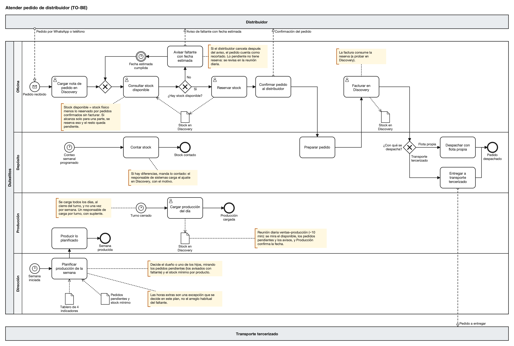

# Proceso futuro (TO-BE)

Así se atendería un pedido con la alternativa recomendada, el stock en Discovery, que antes se prueba durante 2 semanas en una planilla con la misma regla. Respecto de hoy cambia el orden, porque primero se mira qué hay y después se confirma, y la producción pasa a mirar los pedidos.

## Diagrama TO-BE

Usa los mismos carriles que el AS-IS, y el ícono de persona marca los pasos que se hacen en Discovery. El diagrama completo se adjunta en formato BPMN.

Oficina carga la nota de pedido una sola vez y consulta el stock disponible. Si hay, reserva y confirma, Depósito arma con la lista que sale de Discovery y la factura consume la reserva. Si no hay, Oficina avisa en el momento con la fecha que Producción confirma en la reunión diaria, y el pedido queda pendiente; si alcanza solo para una parte, esa parte se despacha únicamente si el distribuidor lo acepta. Cada semana Dirección planifica la producción con los pedidos pendientes y un stock mínimo, Producción carga lo producido al cierre del turno y Depósito hace un conteo que, si encuentra diferencias, se ajusta en Discovery.

El diagrama da por ciertas tres cosas que todavía no probamos: que Discovery reserva y la factura consume la reserva (supuesto 3), que la fecha estimada se cumple (supuesto 4) y que la producción se planifica mirando los pedidos (supuesto 5).

## Qué cambia

| Paso | Hoy | Con la propuesta |
|---|---|---|
| Registrar el pedido | Se anota tres veces (chat, papel o planilla y lista) | Una sola vez, como nota de pedido en Discovery |
| Saber si hay | Se mira el depósito y se pregunta a Producción; el faltante aparece al armar | Se consulta el stock disponible antes de confirmar |
| Resolver el faltante | Sale incompleto, espera producción o se hacen horas extras | Aviso en el momento, con fecha, y pedido pendiente a la vista |
| Qué se produce | Lo decide el dueño o un hijo sin mirar pedidos | Plan semanal contra pedidos y stock mínimo |
| Cargar lo producido | Una vez por semana | Todos los días, al cierre del turno |
| Horas extras | Una salida habitual del faltante | Excepción del plan semanal, con motivo |

El ingreso por WhatsApp o teléfono, el armado y el despacho siguen igual.

### La regla del stock disponible

Es la misma en la planilla y en Discovery:

**stock disponible = stock físico − reservado por pedidos confirmados sin facturar**

El disponible sube cuando Producción carga lo producido o se libera una reserva, y baja cuando Oficina reserva al confirmar. Al facturar baja el físico pero no el disponible, porque la factura consume la reserva. El conteo semanal ajusta el físico a lo contado.

## Responsables y decisiones

| Actividad | Oficina | Depósito | Producción | Dirección | Resp. de sistemas | Distribuidor (externo) |
|---|---|---|---|---|---|---|
| Cargar pedido, consultar y reservar | R/E | – | – | – | – | – |
| Confirmar o avisar faltante con fecha | R/E | I | C | – | – | I |
| Preparar pedido | I | R/E | – | – | – | – |
| Facturar | R/E | C | – | – | – | I |
| Planificar producción de la semana | C | – | C | R/E | – | – |
| Producir y cargar lo producido | I | I | R/E | I | – | – |
| Contar stock | – | R/E | I | – | I | – |
| Ajustar diferencias de conteo | I | C | I | – | R/E | – |
| Reunión diaria ventas–producción | C | – | C | R/E | – | – |
| Actualizar el tablero | C | – | I | I | R/E | – |

El responsable de sistemas no tiene carril en el diagrama porque es un rol, no un área. A diferencia de hoy, el faltante tiene responsables: Oficina avisa, Producción confirma la fecha y Dirección decide si hacen falta horas extras. Oficina no confirma sin mirar el stock, salvo algún día en que el dato no esté al día, y no promete fechas que Producción no confirmó. Dirección sigue decidiendo qué producir, pero primero va lo pedido que no hay y después lo que está bajo el mínimo.

Antes del piloto hay que acordar con el dueño quién responde por el plan semanal, quién hace los conteos (en principio, Depósito), quiénes son los responsables de carga de cada turno y quién convoca la reunión diaria.

## Datos y controles

En el proceso nuevo el stock se genera en cinco momentos, todos en Discovery: la nota de pedido, la reserva, el parte de producción, la factura y el ajuste del conteo. Las reglas de datos están en la sección 6.

| Riesgo | Control | Cómo se ve si falla |
|---|---|---|
| Confirmar sin saber qué hay | Consultar el disponible antes de confirmar | Días en que se confirmó sin el dato |
| Producir sin mirar los pedidos | Plan semanal y reunión diaria | Pedidos completos que no suben |
| Stock cargado distinto del real | Conteo semanal; manda lo contado | Exactitud de stock |
| Carga que se corta | Responsable por turno, con suplente | Días con producción cargada |
| Reservas viejas | Revisión semanal de reservas abiertas | Reservas vencidas |
| Horas extras habituales | Solo como excepción del plan | Horas extras por mes |

El seguimiento es un tablero simple de cuatro indicadores que el responsable de sistemas actualiza cada semana (sección 8). Para que la rutina no dependa de la memoria, cada momento tiene una lista corta: al cerrar el turno, cargar lo realmente producido; antes de confirmar, consultar y reservar; y una vez por semana, contar, ajustar con motivo, revisar las reservas y actualizar el tablero. El control más importante es la carga diaria, porque sin ella no hay stock confiable, y por eso su tiempo se reserva dentro del turno.
