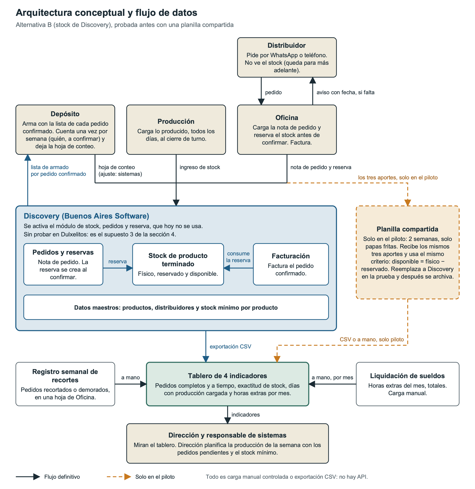

# Arquitectura conceptual y flujo de datos

Para una pyme de 15 a 20 personas alcanza con un flujo simple sobre un solo sistema, y la empresa ya lo tiene: Discovery. Se suman una planilla compartida, solo durante el piloto, y un tablero de cuatro indicadores. No hay sistema nuevo, ni integraciones automáticas, ni canal nuevo.

## Diagrama

Oficina carga pedidos y reservas, Producción lo producido y Depósito la hoja del conteo, que el responsable de sistemas carga como ajuste. Todo entra a Discovery, de donde sale la lista de armado. La planilla va punteada porque solo existe en el piloto, y el distribuidor sigue pidiendo por WhatsApp o teléfono sin ver el stock. El flujo también se adjunta en una versión interactiva.

El diagrama supone que el módulo de stock de Discovery permite pedidos y reserva y que la factura consume la reserva (supuesto 3). Si no fuera así, el mismo flujo funciona con la planilla.

## Datos

| Dato | Tipo | Origen y destino | Uso | Responsable |
|---|---|---|---|---|
| **Productos** | Maestro | Ya están en Discovery | Que pedido, parte y conteo hablen del mismo producto | Responsable de sistemas, a pedido de Dirección |
| **Distribuidores** y su zona | Maestro | Ya están en Discovery; falta ver dónde queda la zona | Saber quién pide y qué plazo de entrega le corresponde | Oficina |
| **Stock mínimo por producto** | Maestro | De Dirección a Discovery, o a una lista aparte si el módulo no lo admite | Planificar la producción | Dirección y responsable de sistemas |
| **Notas de pedido** | Transaccional | Del WhatsApp o el teléfono a Discovery | Confirmar, armar y facturar | Oficina |
| **Reservas** | Transaccional | De la nota confirmada | Calcular el disponible | Oficina |
| **Partes de producción** | Transaccional | De Producción a Discovery, al cierre del turno | Tener el stock físico al día | Responsable de carga del turno |
| **Conteos físicos** | Transaccional | De la hoja de Depósito a un ajuste en Discovery | Ajustar el stock y medir la exactitud | Depósito y responsable de sistemas |
| **Facturas** | Transaccional | De la nota confirmada | Cobrar y consumir la reserva | Oficina |
| **Registro semanal de recortes** | Seguimiento | De Oficina al tablero | Indicador de pedidos completos | Oficina |
| **Horas extras del mes** | Seguimiento | De la liquidación de sueldos al tablero | Indicador de horas extras | Oficina (administración) |

El registro de recortes lleva una línea por pedido con el producto que faltó, qué pasó y el motivo, e incluye los pedidos que ni siquiera llegan a cargarse, porque forman parte del total. El stock disponible no lo carga nadie: lo calcula Discovery, o la planilla en el piloto, con la regla de la sección 3.

## Integraciones

No hay integraciones automáticas. Discovery no se puede integrar con otros sistemas, y tampoco hace falta: son pocas cargas por día y lo que falta es el dato, no la conexión. Todo es carga manual controlada y una exportación a CSV para el tablero.

| Flujo | Cómo y cuándo | Control |
|---|---|---|
| Pedido → Discovery | Carga manual al recibirlo; reserva al confirmar | No se confirma sin ver el disponible |
| Producción → Discovery | Parte diario al cierre del turno | Lo muestra el indicador de días con producción cargada |
| Discovery → Depósito | Lista de armado al confirmar | Solo se arma lo confirmado |
| Depósito → Discovery | Hoja de conteo y ajuste, una vez por semana | La diferencia queda registrada y da la exactitud |
| Discovery → tablero | Exportación CSV semanal (en el piloto, desde la planilla) | Si no coincide, manda Discovery |
| Recortes y horas extras → tablero | Carga manual, semanal y mensual | Un pedido por línea; el total de la liquidación |

Damos por hecho que Discovery exporta a CSV; si no pudiera, los números del tablero son pocos y se pasan a mano. WhatsApp tampoco se integra, porque pediría una API que no existe y un CRM que está fuera de alcance.

## Reglas de datos

Las reglas cubren los datos críticos (stock, reservas, productos, distribuidores y stock mínimo) y son simples a propósito, para que una empresa de este tamaño las pueda cumplir.

1. Un solo lugar por dato. Pedidos y stock viven en Discovery; la planilla existe solo en el piloto y después se archiva, para no tener dos fuentes.
2. Nada se borra. Un error se arregla con un movimiento nuevo y un motivo escrito.
3. Manda lo contado. Si el conteo y Discovery no coinciden, se ajusta Discovery.

Cada rol carga lo suyo: Oficina los pedidos, las reservas, las facturas y los distribuidores; Producción los partes; Depósito la hoja de conteo; y el responsable de sistemas los productos, el stock mínimo, los ajustes y los permisos. Los productos nuevos los da de alta el responsable de sistemas a pedido de Dirección, y los distribuidores, Oficina, buscando antes que no estén ya cargados. Quien carga un dato es quien lo arregla, en lo posible el mismo día. Los productos y distribuidores que dejan de usarse quedan inactivos, y nunca se borra un código con movimientos. Oficina revisa cada semana las reservas abiertas: las que pasaron el plazo de su zona se confirman con el distribuidor y se facturan o se liberan. Si Discovery no permite separar los permisos de esta forma, las reglas se sostienen por procedimiento y se revisan en cada Go/No-Go.
