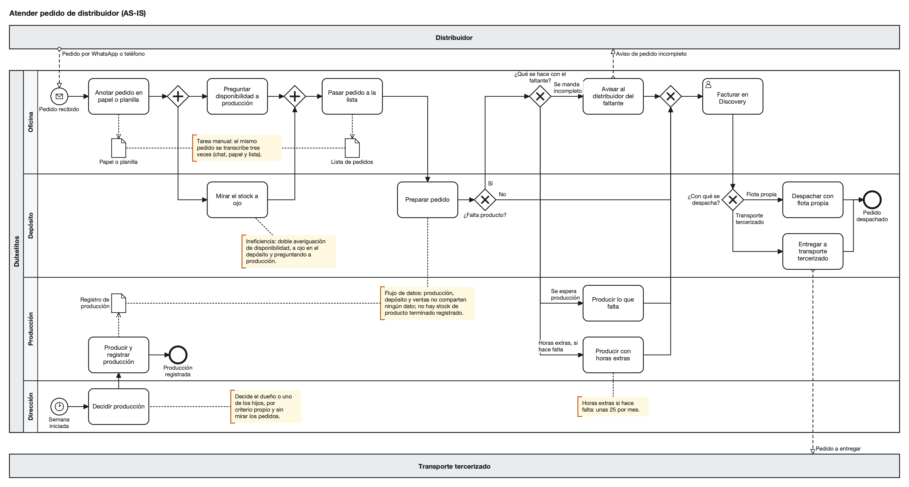
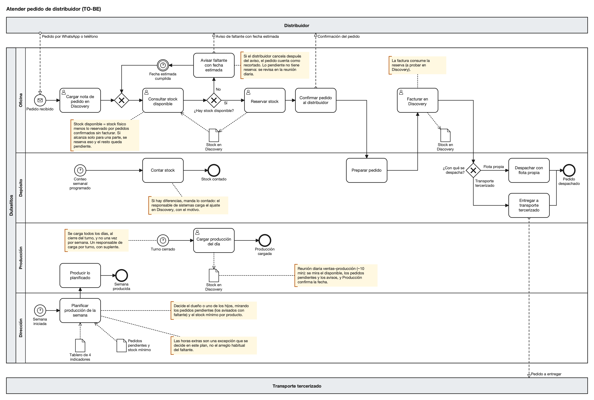
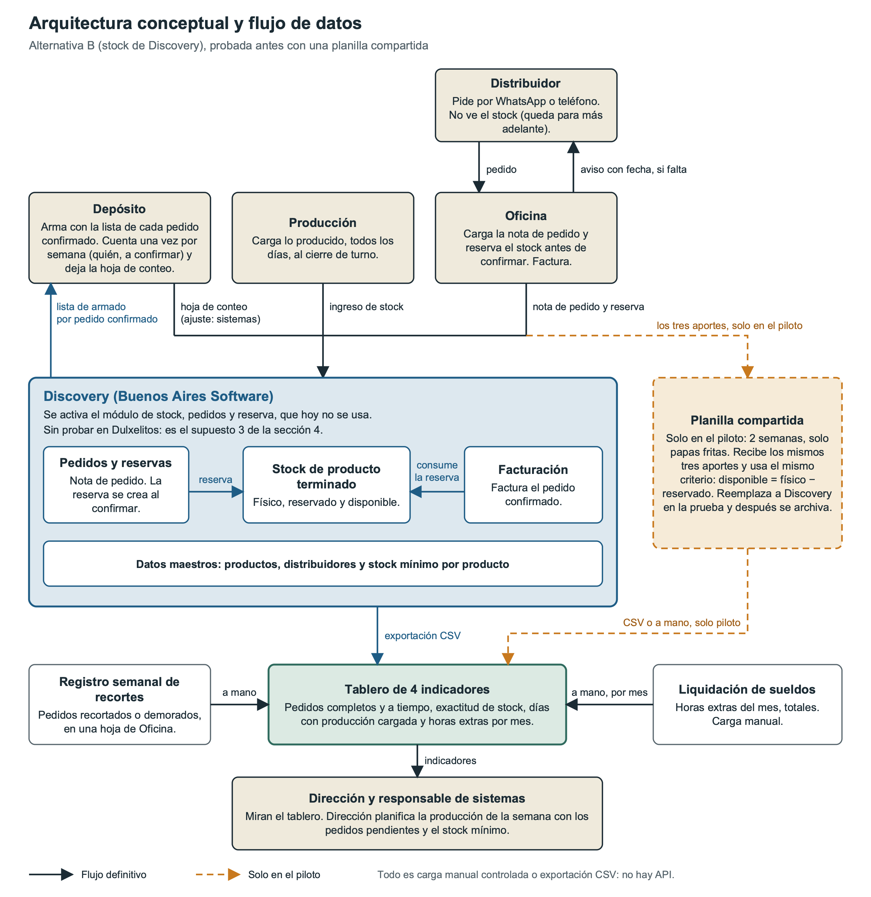

Trabajo Práctico Final - Parte 2

Propuesta de transformación de Dulxelitos

Gestión Gerencial

Ingeniería en Sistemas de Información

Integrantes: Lepez Joaquín, Geyer Juan José, Lopez Juan, Olivares Manuel, Sorato Emiliano

Docentes: Ing. Jeremías Pino, Ing. Martín Noguerol

---

# Índice

- Introducción
- 1\. Problema gerencial, objetivos y alcance
- 2\. Proceso actual y alternativas de solución
- 3\. Proceso futuro (TO-BE)
- 4\. Modelo de negocio y propuesta de valor
- 5\. Stakeholders del proyecto de mejora
- 6\. Arquitectura conceptual y flujo de datos
- 7\. Validación de supuestos
- 8\. Roadmap, OKR e indicadores
- 9\. Bibliografía

---

# Introducción

Este trabajo es la segunda parte del proyecto integrador de Gestión Gerencial. En la primera hicimos un diagnóstico gerencial de Dulxelitos, una empresa familiar de San Rafael que fabrica, fracciona y distribuye snacks desde 1973. En esta pasamos de diagnosticar a proponer: a partir de ese diagnóstico definimos el problema gerencial priorizado, mapeamos el proceso actual y el futuro, comparamos alternativas y armamos el plan para llevar la mejora a la práctica y medir si funciona.

Uno de los integrantes del grupo trabaja en la empresa, y con él relevamos en detalle el proceso de atención de pedidos de distribuidores. Ese relevamiento aportó más precisión sobre tres puntos: el stock de producto terminado no se registra en ningún lado, los pedidos recortados o demorados se repiten todas las semanas y, según creemos, tienen más que ver con qué se produce y cuándo que con la capacidad de la planta. Sobre esa base armamos la propuesta.

La sección 1 plantea el problema, los objetivos y el alcance; la 2 y la 3 describen el proceso actual y el futuro, con las alternativas que evaluamos; la 4, la 5 y la 6 revisan el modelo de negocio, los actores involucrados y la arquitectura de datos, y la 7 y la 8 explican cómo validar la propuesta con un piloto y cómo medirla. Las cifras de partida salen del relevamiento; las metas, los umbrales y los responsables que proponemos son estimaciones del grupo que habría que acordar con el dueño antes de empezar.

---

# 1. Problema gerencial, objetivos y alcance

A partir del diagnóstico de la Parte 1 definimos el problema gerencial priorizado. Lo presentamos acá con los objetivos y el alcance, sobre la base de un relevamiento más detallado del proceso de atender un pedido de distribuidor.

## 1.1 Lo que encontramos en el relevamiento

Del relevamiento surgieron tres cosas que definen el problema.

La facturación está en Discovery, pero el stock de producto terminado no se lleva ahí ni en ningún otro registro. Para saber si hay mercadería se mira en el depósito y se le pregunta a Producción, que mantiene su propio control, lo carga una vez por semana y no lo relaciona con las ventas. El módulo de stock de Discovery está incluido en la licencia y no se usa.

Los pedidos recortados ocurren todas las semanas. En la semana que registramos, 30 de unos 125 pedidos salieron recortados o demorados, cerca del 24 %, de modo que los completos y a tiempo fueron cerca del 76 %. Es el resultado de una sola semana. Esa semana se contaron los pedidos recortados o demorados; si se incluyeron también los rechazados de entrada, lo vamos a confirmar con la empresa.

La planta sigue saturada y las horas extras compensan esa carga al menos en parte. Pero los recortes de cada semana vendrían sobre todo de la mezcla y el momento de producción más que de la capacidad total (supuesto 1): el dueño o los hijos deciden qué producir por criterio propio, sin mirar los pedidos pendientes. Es un supuesto crítico y el piloto nos va a dar una primera lectura.

## 1.2 Problema gerencial

> Dulxelitos recorta o demora 30 de unos 125 pedidos semanales porque los acepta sin conocer el stock de producto terminado, que no se registra, y produce sin mirar las ventas. Genera faltantes y parte de las horas extras (unas 25 mensuales) sobre una planta saturada. Éxito: pedidos completos y a tiempo del 76 % al 90 % en 6 meses.

La causa raíz es en parte técnica, porque no hay registro del stock de producto terminado, y en parte de organización: los pedidos se aceptan y la producción se decide sin mirarse entre sí. Entendemos "a tiempo" como dentro del plazo estándar de cada zona, que en la Patagonia es de hasta una semana, y un pedido rechazado o reprogramado de entrada para mejorar el número no cuenta como completo.

La meta del 90 % la fijamos nosotros: en una pyme con la planta al límite siempre va a haber roturas e imprevistos. Si el piloto muestra que la planificación de la producción explica menos de lo que suponemos, la revisamos.

## 1.3 Objetivo general

Que cada pedido de distribuidor se confirme sabiendo qué hay en stock de producto terminado, y que la producción se planifique contra los pedidos pendientes, para llevar los pedidos completos y a tiempo del 76 % al 90 % en un plazo de 6 meses.

Abarca el proceso "Atender pedido de distribuidor", de la recepción al despacho, y la planificación semanal de producción. Puede comenzar en cualquier momento del año, porque la demanda se mantiene estable.

## 1.4 Objetivos específicos

Son tres, cada uno con una métrica que la empresa puede obtener, una línea de base y una meta con plazo.

### 1. Que los pedidos se confirmen sabiendo qué hay en stock

- Métrica: pedidos completos y a tiempo sobre pedidos recibidos, por semana.
- Línea de base: 76 % (30 recortados o demorados de unos 125, en una semana de registro).
- Meta: 90 % en 6 meses.

### 2. Que la producción se cargue todos los días

- Métrica: días hábiles con producción cargada sobre días hábiles.
- Línea de base: 20 %, porque hoy se carga una vez por semana.
- Meta: 100 % de los días hábiles dentro de los 6 meses. La primera prueba es un piloto de 2 semanas con papas fritas (línea Salados), el producto con más faltantes.

### 3. Que bajen las horas extras

- Métrica: horas extras totales por mes, de la liquidación de sueldos.
- Línea de base: unas 25 horas por mes.
- Meta: la mitad, unas 12 o 13 horas por mes, en 6 meses. Depende de que al menos la mitad de esas horas se haga para completar pedidos que faltaron por la mezcla y el momento de producción; lo que responde a la falta de capacidad no baja. La liquidación no distingue una causa de la otra, así que si la meta queda corta o larga se va a ver con los primeros meses de medición.
- Costo: para llevarlo a pesos falta el costo de la hora extra, que vamos a pedir a liquidación de sueldos.

Hay además otro indicador, la exactitud de stock, que funciona como condición de los otros tres: si lo cargado no coincide con el conteo físico semanal, ninguno se sostiene. Su línea de base sale del primer conteo físico, y la meta provisional es que al menos 9 de cada 10 productos queden sin diferencia mayor a la tolerancia de la sección 7 en 6 meses. Las fichas de los cuatro indicadores están en la sección 8.

## 1.5 Alcance

El proceso es "Atender pedido de distribuidor": empieza cuando llega el pedido por WhatsApp o teléfono y termina con el pedido facturado en Discovery y despachado. Incluye la planificación semanal de producción contra pedidos y los indicadores, con su rutina de seguimiento.

Participan Oficina, Depósito, Producción y Dirección (el dueño y los hijos). El dueño es el sponsor y aprueba el presupuesto y los Go/No-Go. El líder es el responsable de sistemas: el diagnóstico de la Parte 1 marcó la gobernanza digital como una debilidad y la propuesta se la asigna a él. Los distribuidores y el transporte tercerizado no cambian su trabajo: siguen pidiendo por WhatsApp o teléfono y, si falta algo, se les avisa en el momento, con fecha estimada si Producción ya la confirmó.

En el trabajo diario, Producción carga lo producido todos los días, al cierre de cada turno, aunque falta relevar cuántos turnos tiene la planta. Oficina consulta el stock y lo reserva antes de confirmar un pedido. Dirección planifica la producción de la semana mirando los pedidos pendientes y un stock mínimo por producto. Se suman una reunión diaria corta entre ventas y producción, de unos 10 minutos, y un conteo cíclico semanal.

Hacen falta disciplina de carga diaria, un responsable de carga por turno con suplente y un criterio único de stock disponible. Los datos son el stock físico de producto terminado, las reservas por pedido confirmado sin facturar, los pedidos pendientes, el stock mínimo y las horas extras, con una sola definición: **stock disponible = stock físico menos lo reservado por pedidos confirmados sin facturar.** Las herramientas son Discovery, que la empresa ya tiene, para facturar y para el módulo de stock, pedidos y reserva que hoy no se usa, y una planilla compartida para el piloto de 2 semanas; cuál va como solución y cuál como prueba se justifica en la sección 2.

## 1.6 Fuera de alcance

- Insumos y packaging: también tienen problemas, que exceden este proyecto. Quedan declarados como deuda, y el proveedor único de film ya figura como riesgo en la Parte 1.
- Visibilidad de stock para el distribuidor: por ahora el stock es solo interno. Queda en el roadmap para más adelante, junto con la tienda online de 2020.
- Ampliación de planta: la capacidad total no cambia, y el proyecto apunta a qué se produce y cuándo.
- Cambiar Discovery por otro sistema: evaluamos un SaaS de gestión y lo descartamos en la sección 2.
- CRM: es un problema real identificado en la Parte 1 (Clientes y Canales) que se deja para una etapa posterior.
- Costeo y listas de precios: tampoco se tocan.

Algunas tareas se mantienen manuales a propósito: el armado del pedido en el depósito, que según el relevamiento es rápido y no se mide, así que no es la restricción; el conteo físico; y la decisión de qué producir, que sigue siendo del dueño y de los hijos aunque ahora la toman mirando pedidos y stock.

---

# 2. Proceso actual y alternativas de solución

Describimos el proceso tal como funciona hoy, con los volúmenes y tiempos que relevamos en la empresa.

## 2.1 Matriz de descubrimiento

| Campo | Contenido |
|---|---|
| **Nombre** | Atender pedido de distribuidor |
| **Empieza cuando** | Llega un pedido del distribuidor por WhatsApp o por teléfono |
| **Termina (camino feliz)** | El pedido queda facturado en Discovery y despachado |
| **Áreas involucradas** | Oficina, Depósito, Producción y Dirección (el dueño y los hijos) |
| **Actores externos** | El distribuidor, que inicia el proceso y recibe el resultado, y el transporte tercerizado si no hay flota propia |
| **Volumen y periodicidad** | ~25 pedidos por día y ~125 por semana, con una demanda estable durante todo el año |
| **Camino alternativo frecuente** | Falta producto: en la semana que registramos, 30 de ~125 pedidos salieron recortados o demorados (~24 %) |
| **Fuera de los límites** | Insumos y packaging, y la visibilidad de stock para el distribuidor (sección 1) |

## 2.2 SIPOC

Son seis pasos; el cuarto, alternativo, ocurre todas las semanas.

| # | Proveedor | Entrada | Proceso | Salida | Cliente |
|---|---|---|---|---|---|
| 1 | Distribuidor (externo) | Pedido por WhatsApp o teléfono | Recibir pedido | Pedido anotado en papel o planilla | Oficina (paso 2) |
| 2 | Depósito y Producción | Pedido anotado; lo que se ve en el depósito; lo que contesta Producción | Verificar disponibilidad | Disponibilidad conocida y pedido pasado a la lista | Depósito (paso 3) |
| 3 | Oficina y Producción | Lista de pedidos y producto terminado | Preparar pedido | Pedido armado, completo o con faltante | Oficina (pasos 4 y 5) |
| 4 | Depósito y Producción | Faltante detectado al armar | Resolver faltante (solo si falta producto) | Aviso al distribuidor, o producción con o sin horas extras | Distribuidor y Oficina |
| 5 | Depósito | Pedido armado o completado | Facturar pedido | Pedido facturado en Discovery | Distribuidor y Depósito (paso 6) |
| 6 | Oficina | Pedido facturado | Despachar pedido | Pedido despachado | Distribuidor y transporte tercerizado |

## 2.3 RECI

R es el responsable (uno solo por actividad), E el ejecutor, C el consultado e I el informado. En una pyme quien ejecuta suele responder, por eso todas las filas son R/E.

| Actividad | Oficina | Depósito | Producción | Dirección | Distribuidor (externo) | Transporte tercerizado (externo) |
|---|---|---|---|---|---|---|
| Anotar pedido en papel o planilla | R/E | – | – | – | – | – |
| Preguntar disponibilidad a producción | R/E | – | C | – | – | – |
| Mirar el stock a ojo | I | R/E | – | – | – | – |
| Pasar pedido a la lista | R/E | I | – | – | – | – |
| Preparar pedido | I | R/E | – | – | – | – |
| Avisar al distribuidor del faltante | R/E | C | – | – | I | – |
| Producir lo que falta | I | I | R/E | C* | – | – |
| Producir con horas extras | I | I | R/E | C* | – | – |
| Facturar en Discovery | R/E | C | – | – | I | – |
| Despachar con flota propia | I | R/E | – | – | I | – |
| Entregar a transporte tercerizado | I | R/E | – | – | I | I |
| Decidir producción | – | – | I | R/E | – | – |
| Producir lo decidido | – | – | R/E | I | – | – |
| Registrar producción de la semana | – | – | R/E | – | – | – |

\* Como el dueño o los hijos deciden la producción, entendemos que producir de más o con horas extras se consulta con Dirección.

"Decidir producción" no tiene a nadie consultado, ni Oficina ni Depósito, que conocen los pedidos, y Dirección tiene una sola R aunque decide el dueño o uno de los hijos, sin definir cuál. La compuerta "¿Qué se hace con el faltante?" tampoco tiene un responsable relevado: quién decide entre mandar incompleto, esperar producción o hacer horas extras, y quién autoriza estas últimas, lo vamos a definir con el dueño antes del piloto.

## 2.4 Diagrama AS-IS

El pedido nace en el mensaje del distribuidor. Oficina lo anota y, en paralelo, pregunta a Producción mientras Depósito mira el stock; con las dos respuestas pasa el pedido a la lista y Depósito lo prepara. "¿Falta producto?" viene después de preparar, porque la averiguación previa no alcanza para saberlo, y sus tres salidas (mandar incompleto avisando, esperar producción o producir con horas extras) se juntan antes de facturar y despachar. El diagrama completo se adjunta en formato BPMN.

En los carriles de abajo, el dueño o uno de los hijos decide cada semana qué producir según su criterio y sin mirar los pedidos, y Producción registra lo producido una sola vez por semana, es decir, el 20 % de los días hábiles, sin cruzarlo con las ventas. Buena parte del proceso se sostiene en la memoria de las personas: el pedido original vive en el chat o en la llamada y lo demás son copias a mano que nadie más ve.

| Aspecto | Hoy |
|---|---|
| Actores y pasos | Los 4 carriles y los 2 externos; 14 actividades (11 del pedido y 3 de producción) |
| Entradas y salidas | Entra el pedido; sale facturado y despachado, o con aviso de incompleto |
| Herramientas | WhatsApp, teléfono, papel o planilla y lista de pedidos; Discovery, solo para facturar; control de producción semanal |
| Dolores | Recortes y demoras todas las semanas; faltantes que aparecen al armar; horas extras; producción que no mira los pedidos |
| Costos | ~25 horas extras por mes, en parte para completar pedidos, y el margen perdido en los pedidos recortados |
| Indicadores y línea de base | Pedidos completos y a tiempo: 76 % (estimado sobre una semana). Días con producción cargada: 20 %. Horas extras: ~25 por mes. Exactitud de stock: no existe porque no hay stock registrado |
| Lo que no es el problema | El armado del pedido: es rápido y no se mide |

## 2.5 Tres lentes

Miramos el diagrama AS-IS desde tres ángulos: las ineficiencias, las tareas manuales y el flujo de datos.

Hay ineficiencias en la disponibilidad, que se averigua dos veces, preguntando a Producción y mirando el depósito, y en el faltante, que obliga a esperar a producción o a hacer horas extras antes de facturar. Automatizar el flujo tal como está no lo arregla: hay que reservar el stock contra los pedidos antes de confirmarlos.

Las tareas manuales se repiten: el mismo pedido se anota tres veces (chat, papel o planilla y lista) y en cada copia puede equivocarse un producto o una cantidad. La intervención es cargarlo una sola vez y que de ahí salgan la reserva y la lista de armado.

En el flujo de datos, Producción, Depósito y ventas no comparten nada: no hay stock de producto terminado registrado y lo producido se carga una vez por semana en un control que no se cruza con los pedidos. Es el silo más grande; la intervención es un registro de stock cargado todos los días, con un solo criterio de stock disponible: stock físico menos lo reservado por pedidos confirmados sin facturar.

Como las tres lentes apuntan a la misma causa, ordenamos los pasos de una misma solución: primero la planilla del piloto, una mejora rápida, y después el stock en Discovery, una inversión de impacto alto.

## 2.6 Alternativas

### Do Nothing: seguir igual

Sin inversión, pero con el costo de seguir igual: los recortes y demoras de todas las semanas, un margen perdido en los pedidos recortados y unas 25 horas extras por mes, de las cuales solo una parte sirve para completar pedidos; el resto responde a la capacidad de la planta, tema que queda fuera de alcance. La producción sigue decidiéndose a criterio del dueño y los hijos.

### A. Planilla compartida (incremental)

Una planilla compartida de stock de producto terminado: Producción carga lo producido al cierre de cada turno, Oficina reserva por pedido confirmado y ventas y Producción se reúnen unos 10 minutos por día. Cuesta casi nada, apenas tiempo de carga, de reunión y de conteo. Se probaría como piloto de 2 semanas con papas fritas, el producto con más faltantes.

Permite comprobar con poco riesgo que Producción y Oficina sostienen la carga diaria (supuesto 2 de la sección 4) y tener una primera lectura de si planificar contra pedidos baja los recortes (supuesto 1). Pero no se conecta con Discovery: al facturar hay que bajar el físico y descontar la reserva a mano, el pedido se carga dos veces y escala mal a todos los productos.

### B. Stock de Discovery (intermedia, recomendada)

Consiste en activar el módulo de stock de Discovery, que según el relevamiento está incluido en la licencia, permite pedidos y reserva, y la empresa nunca usó. Incluye un conteo físico inicial, la activación línea por línea (Salados, Dulces y Repostería) con el mismo criterio de stock disponible y la misma rutina que A (sección 3), un responsable de carga por turno con suplente y un conteo cíclico semanal. No hay licencia nueva: el costo está en el conteo, la capacitación, el tiempo de carga y lo que el proveedor cobre por soporte, repartido en los 6 meses del plazo.

Deja un solo registro de stock en la herramienta donde ya se factura, con el pedido cargado una vez y la reserva consumida por la factura, si el módulo funciona como esperamos (supuesto 3). No resuelve que la producción se decida mirando pedidos, que es un cambio de criterio de Dirección y no de herramienta, ni la saturación de la planta. Como riesgo, en la Parte 1 identificamos que Discovery está desactualizado y con errores, y no sabemos qué versión usa la empresa, qué soporte incluye, cuánto cuesta ni cuánto tarda activar el módulo; se lo vamos a preguntar al proveedor.

### C. SaaS de gestión (integral, evaluada y descartada)

Un sistema de gestión en la nube para pedidos y stock, que conviviría con Discovery o lo reemplazaría, con cuota mensual nueva, migración, capacitación y, si Discovery sigue para facturar, su costo también. No pedimos cotizaciones; la evaluamos como categoría. Tendría todo en un solo lugar y escalaría mejor, pero no resuelve la disciplina de carga. Como Discovery no se integra con otros sistemas, quedaría al lado con carga manual en los dos. Reemplazarlo está fuera de alcance (sección 1).

## 2.7 Matriz multicriterio

Usamos diez criterios y comparamos las alternativas como solución para los 6 meses y todos los productos, no como piloto. La escala va de 1 a 5 y 5 es siempre lo más favorable para la empresa, es decir, lo más barato, rápido y simple.

| Criterio | Do Nothing | A. Planilla compartida | B. Stock de Discovery | C. SaaS |
|---|---|---|---|---|
| **1. Alineación al negocio** (¿ataca la causa?) | 1 – No toca la causa | 3 – Registra y reserva, pero no cambia cómo se decide producir | 4 – Registra, reserva y factura en un lugar; producir mirando pedidos sigue siendo otro cambio | 3 – Cubre pedido y stock, no la decisión de producir |
| **2. Costo** | 5 – No hay inversión | 5 – Casi nulo | 4 – Sin licencia nueva; conteo, capacitación y activación | 2 – Cuota, migración y capacitación, más Discovery |
| **3. Viabilidad operativa** | 3 – Es lo de hoy, con horas extras | 3 – Liviana con un producto; con todos, la doble carga pesa | 3 – Una carga, pero diaria y sobre un módulo que nadie usó | 2 – Migrar y capacitar con la planta al límite |
| **4. Tiempo** | 1 – No hay efecto nunca | 5 – Sin proveedor; piloto de 2 semanas | 3 – Activar con el proveedor y contar por línea | 2 – Elegir, contratar, migrar y capacitar |
| **5. Adopción** | 5 – No pide nada, y tampoco mejora | 3 – Formato familiar, pero doble carga | 3 – Una carga, en una herramienta que nadie usó para esto | 2 – Pantallas nuevas y doble carga |
| **6. Complejidad** | 5 – Ninguna | 3 – Simple, pero descontar a mano es propenso a errores | 3 – Configurar pedido, reserva y consumo; depende de la versión de Discovery | 1 – Dos sistemas que no se integran, más una migración |
| **7. Capacidad interna** | 5 – No hace falta nada | 4 – Lo arma el responsable de sistemas, según el tiempo que pueda dedicarle | 3 – Depende de Buenos Aires Software y del responsable de sistemas | 2 – Proveedor nuevo y dos sistemas |
| **8. Integración** | 1 – Nada se conecta | 2 – La planilla no habla con Discovery | 4 – Todo en Discovery, si la factura consume la reserva (supuesto 3) | 2 – Discovery no se integra: carga manual en los dos |
| **9. Flujo de caja** | 3 – No sale dinero nuevo, pero siguen las horas extras | 5 – Casi nada, y se puede cortar sin perder inversión | 4 – Sin cuota nueva; gasto puntual que el dueño evaluaría por su retorno | 2 – Cuota fija en una empresa que cobra de contado, a ~30 días o con cheques diferidos |
| **10. Continuidad operativa** | 2 – Sin registro, depende de las personas | 3 – No corta nada, pero es un archivo suelto | 4 – Una sola fuente, con suplente; riesgo: Discovery desactualizado | 2 – Suma un proveedor y una migración |
| **Total (suma simple, máximo 50)** | 31 | 36 | 35 | 20 |

C queda descartada: tiene la suma más baja y no es la mejor en ningún criterio. Do Nothing llega a 31 porque no pide inversión ni cambios y por eso puntúa 5 en costo, adopción, complejidad y capacidad interna, pero no resuelve el problema (alineación 1 e integración 1). Entre A y B hay un solo punto, una diferencia demasiado chica para decidir. Probamos también otros pesos, solo como referencia, porque A y B quedaron muy parejos: B supera a A si alineación, integración y continuidad operativa pesan más de 1,25 veces lo que el resto (empatan en 38); con más peso en costo, tiempo y flujo de caja solo crece la ventaja de A.

Decide el argumento cualitativo. Las notas bajas de A son estructurales (integración 2, alineación 3, continuidad 3) y no mejoran con la práctica, porque la planilla vive aparte de Discovery. Las medias de B son incógnitas, porque nadie usó ese módulo en Dulxelitos, y pueden subir o bajar cuando se sepa. Por eso A va primero, como paso 1 y MVP: el piloto, la prueba técnica y la activación por línea despejan las incógnitas de B, que es el destino.

## 2.8 Recomendación

Recomendamos B, el stock de Discovery, con A, la planilla compartida, como piloto de 2 semanas sobre papas fritas. B es la solución del proceso nuevo y A sirve para probarla antes de gastar.

Si el equipo no sostiene la carga diaria en una planilla simple, tampoco la va a sostener en Discovery, y pagar la herramienta no resolvería el problema de carga. Además, cargar stock sin cambiar cómo se decide producir no baja los recortes (supuesto 5), por eso B va junto con el rediseño de la sección 3. El piloto prueba la carga diaria (supuesto 2) y da una primera lectura de si planificar contra pedidos baja los recortes (supuesto 1). El supuesto 3, que Discovery reserve y que la factura consuma la reserva, lo verifica la prueba técnica de la sección 7 antes del Go, salvo el paso de la factura si no hay ambiente de prueba; los umbrales y el Go/No-Go están en las secciones 7 y 8.

El dueño está dispuesto a invertir si se demuestra el retorno, y el ahorro principal de B se puede medir en la liquidación de sueldos. En lugar de un VAN usamos un punto de equilibrio, que la sección 4 retoma: B se paga si evita por mes tantas horas extras como resulte de dividir su costo mensual por el costo de la hora extra, repartiendo en los 6 meses lo que se paga una sola vez. Si el cociente da menos de unas 12 o 13 horas por mes, que es la meta de la sección 1, con solo cumplirla B se paga. No sumamos el margen de los pedidos que dejan de recortarse, así que la cuenta es conservadora. El punto de equilibrio compara B con no hacer nada y no con A: lo que B agrega es una sola carga que integra pedido, reserva y factura y escala a más de 25 combinaciones de producto y formato, como identificamos en la Parte 1. El plazo de recupero lo decide el dueño.

---

# 3. Proceso futuro (TO-BE)

Así se atendería un pedido con la alternativa recomendada en la sección 2, el stock de Discovery. Antes se prueba durante 2 semanas con papas fritas sobre una planilla compartida, con el mismo flujo y la misma regla de stock; lo único que cambia es dónde se registra. Respecto de hoy, cambia el orden (primero se mira qué hay y después se confirma) y la producción pasa a conectarse con los pedidos.

## 3.1 Diagrama TO-BE

El diagrama usa los mismos carriles y actores externos que el AS-IS de la sección 2, y el ícono de persona marca los pasos que se hacen en Discovery. El diagrama completo se adjunta en formato BPMN. Los tres objetos "Stock en Discovery" son el mismo registro, repetido para no cruzar carriles.

Oficina carga la nota de pedido una sola vez y consulta el stock disponible antes de confirmar. Si hay, reserva y confirma, y Depósito arma con la lista que Discovery genera (sección 6). Después Oficina factura y la factura consume la reserva. El despacho es como hoy.

Si no hay, Oficina avisa en el momento con la fecha estimada que Producción confirma en la reunión diaria; si todavía no la confirmó, avisa del faltante sin fecha y la da después de la próxima reunión. El pedido queda pendiente, sin reserva, hasta que llega la fecha y Oficina vuelve a consultar. "Hay" quiere decir que alcanza para el pedido completo; si alcanza solo para una parte, se reserva esa parte y se despacha únicamente si el distribuidor lo acepta y, si no, el pedido espera completo (sección 6). Si el distribuidor cancela tras el aviso, el pedido cuenta como recortado (sección 7).

Cada semana Dirección planifica y Producción produce lo planificado. La carga diaria, con el cierre del turno, sube el stock físico en Discovery; en Repostería, producto de terceros que Dulxelitos solo envasa, se carga lo envasado.

Una vez por semana Depósito cuenta el stock; si hay diferencias, manda lo contado y el responsable de sistemas carga el ajuste con su motivo.

Hay tres cosas que el diagrama da por ciertas y todavía no probamos: que Discovery reserva, incluso una parte de un pedido, y que la factura consume la reserva (supuesto 3, que verifica la prueba técnica de la sección 7); que la fecha estimada se cumple (supuesto 4); y que el dueño y los hijos planifican mirando pedidos y stock mínimo (supuesto 5).

## 3.2 Qué cambia

| Paso | Hoy (AS-IS) | Futuro (TO-BE) |
|---|---|---|
| Registrar el pedido | Se anota en papel o planilla y se pasa a una lista: el mismo pedido se anota tres veces (chat, papel o planilla y lista) | Se carga una sola vez como nota de pedido en Discovery |
| Saber si hay | Se mira en el depósito y se pregunta a Producción; el faltante aparece al armar, con el pedido ya aceptado | Una consulta del stock disponible en Discovery antes de confirmar |
| Avisar al distribuidor y resolver el faltante | Se acepta con una averiguación que no alcanza; si falta, tres salidas: mandar incompleto, esperar producción u horas extras | Se confirma lo que hay, con reserva; si falta, aviso en el momento con fecha y pedido pendiente a la vista de Dirección |
| Qué se produce | Lo decide el dueño o uno de los hijos, sin mirar los pedidos | Plan semanal contra pedidos pendientes y stock mínimo; sigue decidiendo Dirección |
| Cargar lo producido | Una vez por semana (20 % de los días), en un control propio sin relación con ventas | Todos los días, al cierre del turno, con responsable de carga por turno y suplente |
| Horas extras | Una de las tres salidas del faltante (parte de las horas extras del mes) | Excepción del plan semanal, con motivo anotado |

Siguen igual el ingreso del pedido por WhatsApp o teléfono, el armado manual en el depósito (según el relevamiento es rápido y no es la restricción) y el despacho, propio o tercerizado. El distribuidor tampoco ve el stock, algo que queda para más adelante (sección 1).

### La regla del stock disponible

Es la misma en Discovery y en la planilla del piloto, y con ella contesta Oficina al distribuidor:

**stock disponible = stock físico − reservado por pedidos confirmados sin facturar**

| Qué pasa | Stock físico | Reservado | Disponible |
|---|---|---|---|
| Producción carga lo producido | Sube | Igual | Sube |
| Oficina reserva al confirmar | Igual | Sube | Baja |
| Oficina factura (consume la reserva) | Baja | Baja | Igual |
| Se libera una reserva (cancelación o pedido rehecho) | Igual | Baja | Sube |
| El conteo encuentra una diferencia | Se ajusta a lo contado | Igual | Cambia con el físico |

## 3.3 Responsables y decisiones

Seguimos el RECI de la sección 2, con una sola R por actividad; como en una pyme quien ejecuta suele ser quien responde, casi todo es R/E. Sumamos al responsable de sistemas, que ejecuta dos pasos (ajustes de stock y tablero) y, por ser un rol, no tiene carril. Los asteriscos marcan lo que falta acordar con cada área.

| Actividad | Oficina | Depósito | Producción | Dirección | Resp. de sistemas | Distribuidor (externo) |
|---|---|---|---|---|---|---|
| Cargar nota de pedido, consultar stock disponible y reservar | R/E | – | – | – | – | – |
| Confirmar pedido al distribuidor | R/E | I | – | – | – | I |
| Avisar faltante con fecha estimada | R/E | – | C | – | – | I |
| Preparar pedido | I | R/E | – | – | – | – |
| Facturar en Discovery | R/E | C | – | – | – | I |
| Planificar producción de la semana | C* | – | C* | R/E | – | – |
| Producir lo planificado | I | I | R/E | I | – | – |
| Cargar producción del día | I | I | R/E | – | – | – |
| Contar stock | – | R/E (a confirmar) | I | – | I | – |
| Ajustar diferencias de conteo | I | C | I | – | R/E | – |
| Reunión diaria ventas–producción* | C | – | C | R/E | – | – |
| Actualizar el tablero* | C | – | I | I | R/E | – |

Respecto del AS-IS, el faltante pasa a tener responsable, ya que Oficina avisa, Producción confirma la fecha y Dirección decide las horas extras en el plan semanal. Además, "Planificar" ahora tiene consultados: Oficina aporta los pedidos y Producción dice qué puede producir.

Oficina decide si se confirma un pedido con el stock disponible; solo el día en que el dato no está al día se confirma sin él (vuelta atrás, sección 7). La fecha la confirma Producción con el plan semanal y la producción en curso, y Oficina no promete una que Producción no confirmó. Dirección decide qué se produce con los pedidos pendientes, incluidos los avisados con faltante, el disponible frente al stock mínimo y el tablero. Va primero lo pedido que no hay y después lo que está bajo el mínimo; el criterio de Dirección sigue contando, pero deja de ser el único dato. Las diferencias de conteo las ajusta el responsable de sistemas en Discovery, con motivo y sin editar el stock a mano, a partir de la hoja de Depósito; si un producto difiere semana tras semana, se trata en la reunión diaria.

Quedan cuatro puntos abiertos para resolver con el dueño antes del piloto. Falta decidir cuál de los decisores, él o algún hijo, responde por el plan semanal. Para el conteo, inicial y semanal, proponemos a Depósito, pero no relevamos quién lo haría. También hay que nombrar al responsable de carga de cada turno y a su suplente. Y alguien tiene que convocar la reunión diaria; sugerimos a Dirección, aunque queda por definir si participa el dueño o un hijo todos los días.

## 3.4 Datos y controles

Hoy el stock de producto terminado no se registra. En el proceso nuevo se genera en cinco momentos, todos en Discovery: la nota de pedido, la reserva, el parte de producción al cierre del turno, la factura y el ajuste del conteo semanal. Las reglas de carga, ajuste y depuración están en la sección 6.

### Controles

| Error de hoy | Control en el proceso nuevo | Cómo se ve si falla |
|---|---|---|
| Confirmar sin saber qué hay | Consultar el disponible antes de confirmar | Días en que se confirmó sin el dato al día, que el piloto anota (sección 7) |
| Producir sin mirar los pedidos | Plan semanal con pedidos pendientes y stock mínimo, y reunión diaria | Pedidos sin cubrir que la reunión no mueve (supuesto 5) y el indicador de pedidos completos que no sube |
| Stock cargado que no coincide con el real | Conteo cíclico semanal; manda lo contado | Exactitud de stock |
| Carga que se corta | Responsable de carga por turno, con suplente | Días con producción cargada |
| Reservas viejas que bajan el disponible | Oficina revisa cada semana las reservas abiertas; las que pasaron el plazo de su zona se confirman con el distribuidor y se facturan o se liberan | Reservas abiertas en esa revisión (sección 6) |
| Horas extras como arreglo habitual | Excepción del plan semanal, con motivo anotado | Horas extras por mes |

### Seguimiento simple

El tablero es una hoja de 4 indicadores que el responsable de sistemas actualiza cada semana con la exportación de Discovery y dos cargas manuales (sección 6); la ficha y la meta de cada uno están en la sección 8.

*Cierre de turno (responsable de carga o suplente)*

- [ ] Cargué lo realmente producido de cada producto, no lo planificado.
- [ ] Si me equivoqué en una carga de hoy, la ajusté el mismo día, con motivo.
- [ ] Si no pude cargar, lo avisé para anotarlo en la reunión.

*Antes de confirmar un pedido (Oficina)*

- [ ] Cargué el pedido una sola vez y consulté el stock disponible.
- [ ] Si alcanzaba, reservé antes de confirmar; si no, avisé del faltante con la fecha de Producción o sin fecha.

*Cada semana, un día fijo a acordar con Depósito (Depósito, Oficina y responsable de sistemas)*

- [ ] Depósito contó y dejó la hoja de conteo.
- [ ] Se cargaron los ajustes, cada uno con su motivo.
- [ ] Oficina revisó las reservas abiertas: las vencidas se confirmaron o se liberaron.
- [ ] Se actualizó el tablero.

El responsable de carga, una persona por turno con suplente, se encarga de que lo producido llegue a Discovery al cierre. Es el control más importante, ya que sin carga diaria no hay stock confiable, y es trabajo nuevo para Producción (sección 5); el tiempo de carga se reserva dentro del turno.

La reunión diaria entre ventas y producción dura unos 10 minutos y repasa qué hay y qué está pendiente, qué avisos hay abiertos y con qué fecha, y si hay que mover lo que se produce. Ahí se anotan la fecha y la decisión de producción, y se ven las reservas liberadas.

---

# 4. Modelo de negocio y propuesta de valor

La solución recomendada es activar el módulo de stock de Discovery (alternativa B), que antes se prueba con una planilla compartida (alternativa A). Casi todo el cambio es interno: la promesa al distribuidor es la misma y lo que se modifica es la manera de cumplirla.

## 4.1 Cambios en el BMC

Partimos del canvas de la Parte 1, con lo que encontramos al relevar el proceso con más detalle, y separamos el frontstage (lo que ve el distribuidor) del backstage.

### Frontstage

| Bloque | AS-IS | TO-BE | ¿Cambia? |
|---|---|---|---|
| Segmentos de clientes | Distribuidores mayoristas, con foco en la Patagonia, y Aiello | Los mismos | No |
| Propuesta de valor | Precio y logística para el canal. Lo más importante es que la empresa avisa cuando falta algo y no manda lo que no hay | La misma promesa, mejor cumplida: pedidos completos y a tiempo, y un aviso que llega antes | Se refuerza |
| Canales | Pedidos por WhatsApp y teléfono. La tienda del sitio sigue con el catálogo vacío desde 2020 | Iguales; mostrar el stock al distribuidor o terminar la tienda queda para más adelante, porque hoy no hay un stock confiable que mostrar | No |
| Relación con clientes | Se acepta el pedido sin mirar si hay mercadería; si falta, el distribuidor lo sabe al armarlo y recibe un envío incompleto o espera producción | Oficina confirma sabiendo qué hay y, si falta, avisa en el momento, con una fecha estimada si Producción ya la confirmó | Sí, acotado |
| Fuentes de ingreso | Venta mayorista, venta a Aiello y producto fraccionado. Cobran de contado, a ~30 días o con cheques diferidos | Misma estructura. Un pedido recortado es una venta parcial o tardía; cuánto margen se pierde por cada uno queda por calcular | No |

### Backstage

| Bloque | AS-IS | TO-BE | ¿Cambia? |
|---|---|---|---|
| Actividades clave | El dueño o los hijos deciden qué producir por criterio propio. El pedido se confirma mirando el depósito y preguntando a Producción. La administración se reparte entre planillas y un sistema de gestión desconectados | Producción carga lo producido todos los días, al cierre de turno. Oficina consulta y reserva el stock antes de confirmar. Dirección planifica la semana con los pedidos pendientes y un stock mínimo por producto. Reunión diaria de ~10 minutos entre ventas y producción y conteo cíclico semanal | Sí, el principal |
| Recursos clave | La línea de producción al límite y el conocimiento concentrado en los dueños. El stock de producto terminado no existe como recurso porque no se registra | Un recurso nuevo: el registro de stock de producto terminado, con un solo criterio de stock disponible (sección 3), cargado en el módulo de Discovery por una persona en cada turno, con suplente | Sí |
| Socios clave | Proveedor único de packaging y film, proveedores de materia prima, transportistas, distribuidores y Aiello | Los mismos; el proveedor de Discovery pasa a contar, porque hay que activar un módulo que hoy no se usa | Casi no |
| Estructura de costos | Materia prima, packaging, mano de obra, logística, energía y costo financiero. Las ~25 horas extras por mes están dentro de la mano de obra | Sin licencia nueva: según el relevamiento, el módulo ya está incluido en la licencia. Se suman tiempo de carga y de reunión, conteo inicial y capacitación. El ahorro está en las horas extras, valoradas al costo de la hora | Sí, poco |

De los nueve bloques, cuatro cambian: actividades y recursos a fondo, y relación con clientes y costos de forma acotada. Dos cambian apenas, propuesta de valor y socios, y tres quedan igual: segmentos, canales e ingresos. No hay un modelo de negocio nuevo: la capacidad de la planta no se toca, porque la propuesta se ocupa de qué se produce y cuándo. Los ingresos tampoco cambian, y por eso no los usamos para calcular el retorno.

## 4.2 VPC TO-BE

El segmento es el mismo de la Parte 1: el distribuidor mayorista, sobre todo el patagónico. El relevamiento muestra que los faltantes de papas fritas se repiten todas las semanas y que, en la semana registrada, 30 de unos 125 pedidos, de cualquier producto, salieron recortados o demorados. Las papas fritas son el producto con más faltantes.

### Dolores

| Dolor del distribuidor (Parte 1) | Qué hace la propuesta | Efecto |
|---|---|---|
| Faltantes | Planificar contra pedidos pendientes y un stock mínimo ataca la causa más probable, qué se produce y cuándo (supuesto 1). Si falta algo, se avisa al confirmar | Lo alivia; es el dolor central |
| No poder saber si hay stock sin llamar o ir al depósito | El distribuidor sigue llamando, pero Oficina responde con el stock disponible registrado | En parte: mejora la respuesta, aunque no hay autoservicio |
| Horario acotado de atención y paquetes rotos en el viaje | Nada: quedan fuera de alcance | No los toca |

### Ganancias

| Lo que el distribuidor espera (Parte 1) | Qué hace la propuesta | Efecto |
|---|---|---|
| Que le avisen cuando falta algo | Hoy lo hace la empresa, pero recién al armar el pedido. Pasa a avisarse en el momento, con fecha estimada | Se mantiene y mejora |
| Entrega previsible (en la Patagonia, hasta una semana) y compromiso | Confirmar un pedido pasa a significar que hay mercadería o una fecha para completarlo, y que se cumple completo y dentro del plazo estándar de la zona. Es el indicador principal: del 76 % a la meta de la sección 1 | Mejora |
| Precio, exclusividad territorial, catálogo amplio y formatos de reventa | Ninguna acción | Sin cambio |

### Qué beneficio nuevo aparece

Uno solo, menor: saber con una fecha estimada cuándo llega lo que falta. Hoy el distribuidor se entera de que falta algo pero no hasta cuándo; con la producción planificada contra los pedidos, la empresa puede darle una fecha. Es una promesa nueva sobre una planta saturada y, si no se cumple, el aviso pierde el valor que hoy tiene (supuesto 4). No hay beneficio digital nuevo porque no hay canal nuevo. Como hoy la relación con los distribuidores es buena, el cambio beneficia sobre todo a la empresa.

## 4.3 Supuestos clave

Son cosas que damos por ciertas sin haberlas probado, agrupadas en deseabilidad (si lo van a querer y usar), factibilidad (si se puede hacer en esta empresa) y viabilidad (si se paga).

| # | Supuesto | Tipo | Riesgo si es falso |
|---|---|---|---|
| 1 | La mezcla y el momento de producción, y no la capacidad total de la planta, explican la mayoría de los recortes. | Factibilidad (crítico) | Planificar contra pedidos no baja los recortes porque lo que falta es capacidad |
| 2 | Producción carga lo producido todos los días y Oficina consulta y reserva antes de confirmar, aun con la planta saturada y sin gente de más. | Factibilidad | Sin carga diaria no hay stock confiable y se vuelve a mirar el depósito. Es la resistencia que esperamos |
| 3 | El módulo de stock de Discovery permite pedidos, reserva stock y la factura consume la reserva, con el mismo criterio de stock disponible que la planilla del piloto. | Factibilidad | Nadie lo usó en la empresa. Si no funciona así, hay que sumar costo y tiempo con el proveedor o seguir con la planilla (alternativa A) |
| 4 | La fecha estimada que se le da al distribuidor cuando falta algo se cumple, con la planta al límite de su capacidad. | Factibilidad | El aviso deja de ser confiable y se empeora lo que hoy funciona bien |
| 5 | El dueño y los hijos deciden la producción de la semana mirando pedidos pendientes y stock mínimo, además de su criterio. | Deseabilidad | Se registra el stock pero se decide igual que antes y los recortes siguen. Es el cambio adaptativo del proyecto |
| 6 | Al distribuidor no le molesta más oír una fecha estimada al confirmar que recibir el pedido recortado, como hoy. | Deseabilidad | Se pierden pedidos o se resiente una relación que hoy está bien; no hay señal previa de que quiera este cambio |
| 7 | Al menos la mitad de las ~25 horas extras por mes se hace para completar pedidos que faltaron por mezcla y momento de producción. | Viabilidad | Es la base de la meta de horas extras de la sección 1. Si la mayoría responde a la capacidad limitada de la planta, la meta queda larga y el ahorro es menor |
| 8 | El ahorro en horas extras y reprogramaciones justifica el costo de implementar y sostener el cambio, que esperamos bajo. | Viabilidad | La inversión no se recupera |
| 9 | La semana de registro (30 recortados o demorados de ~125) es representativa. | Viabilidad | El tamaño del problema es otro. Se apoya en que la demanda se mantiene estable durante el año, pero hay una sola semana de registro |

El supuesto 1 decide si la propuesta vale la pena. La planta está saturada y eso no cambia; creemos que los recortes vienen sobre todo de producir sin mirar los pedidos, y el piloto va a dar una primera lectura. Si el problema persistiera con la producción bien planificada, habría que revisar la meta.

En lugar de un VAN usamos el punto de equilibrio de la sección 2: B se paga si las horas extras que evita por mes, al costo de la hora, cubren su costo mensual. El tope es de unas 25 horas por mes, las de hoy, y que se llegue a la mitad depende del supuesto 7. El dueño estaría dispuesto a una inversión mayor si el retorno se demuestra. La validación de cada supuesto está en la sección 7.

---

# 5. Stakeholders del proyecto de mejora

Ordenamos a los actores con la matriz poder/interés de Mendelow. El dueño aprueba el presupuesto y el Go/No-Go, pero el cambio lo sostienen todos los días Producción, Oficina y quienes deciden qué producir. Las resistencias de Producción y de Oficina surgen del relevamiento.

## 5.1 Mapa de actores

| Actor y rol | Qué hace en el proceso nuevo |
|---|---|
| **Dueño**: sponsor; con los hijos, decisor de la producción | Aprueba presupuesto y Go/No-Go, y puede ampliar la inversión si se demuestra el retorno; como decisor, planifica con pedidos y stock mínimo |
| **Hijos** (dos): decisores de la producción | Planifican la semana con pedidos pendientes y stock mínimo por producto |
| **Responsable de sistemas**: líder del proyecto | Coordina con el proveedor, capacita, sigue los indicadores, carga los ajustes de stock, mantiene los maestros y exporta el tablero |
| **Oficina** (4 personas: administración, facturación, cobranza): usuarios clave | Cargan la nota de pedido y reservan stock antes de confirmar; si falta algo, avisan con fecha estimada |
| **Producción** (7 personas): usuarios clave, aportan el dato | Cargan lo producido todos los días, al cierre de turno, con un responsable por turno |
| **Depósito** (pedidos, embalaje, envíos): usuarios afectados | Arma desde el pedido confirmado, como hasta ahora; el responsable del conteo cuenta el stock al inicio y cada semana |
| **Buenos Aires Software** (proveedor de Discovery) | Activa el módulo de stock, pedidos y reserva |
| **Distribuidores** (57 en 7 provincias, 35 en la Patagonia): afectados indirectos | Siguen pidiendo por WhatsApp o teléfono; si falta algo, reciben aviso al confirmar, con fecha |

Queda afuera el transporte tercerizado, que no cambia su trabajo (sección 1). El diagnóstico de la Parte 1 marcó la gobernanza digital como una debilidad, porque nadie la tiene asignada; la propuesta se la asigna al responsable de sistemas, con las horas semanales a acordar con el dueño.

## 5.2 Matriz poder/interés

El poder es cuánto puede un actor ayudar o frenar el proyecto, y el interés, cuánto le importa y le toca el cambio. La matriz muestra la posición de cada uno durante la ejecución, con las excepciones entre paréntesis.

| | **Interés bajo** | **Interés alto** |
|---|---|---|
| **Poder alto** | **Mantener satisfecho:** Dueño como sponsor (cerca al comenzar el piloto y la activación), Buenos Aires Software (cerca en la activación) | **Gestionar de cerca:** Dueño como decisor de la producción, Hijos, Responsable de sistemas, Oficina, Producción |
| **Poder bajo** | **Mantener informado:** Distribuidores | **Monitorear y dar voz:** Depósito |

Oficina y Producción tienen poder de hecho, porque cualquiera de las dos frena el proyecto con solo no usarlo. Por saliencia, Producción es una parte definitiva: a ese poder de hecho suma la legitimidad de una planta que ya trabaja al límite y la urgencia de las primeras semanas de carga, y por eso se la atiende primero.

## 5.3 Estrategias de involucramiento

| Actor | Poder, interés e impacto | Resistencia | Estrategia |
|---|---|---|---|
| **Dueño** | Poder alto; interés bajo (sponsor) y alto (decisor); impacto medio y alto | Baja como sponsor, con el riesgo de que no siga los avances; posible como decisor, si siente que pierde su criterio | Sponsor: informe corto y regular, Go/No-Go acordado antes. Decisor: igual que los hijos |
| **Hijos** | Altos los tres | Posible, no relevada: perder peso en la decisión | Siguen decidiendo, con más información, y fijan el stock mínimo |
| **Responsable de sistemas** | Altos; el poder lo delega el dueño | Sobrecarga | Asignación formal con tiempo reservado |
| **Oficina** | Altos; poder de hecho | Esperada: suma un paso | Mostrar qué pasos reemplaza el nuevo; guion de aviso |
| **Producción** | Altos; poder de hecho | Esperada: no tiene margen, y las horas extras pueden ser un ingreso para quien las hace | Escucharlos antes de pedirles un cambio |
| **Depósito** | Poder bajo (sube si le toca el conteo); interés alto, porque sabe cuánto hay; impacto medio | Baja | Dar voz: que valide el primer conteo |
| **Buenos Aires Software** | Poder alto sobre la viabilidad: sin el módulo no hay alternativa B; interés e impacto bajos | Baja; el riesgo es que el módulo no funcione o el soporte tarde | Coordinar la activación con el responsable de sistemas; probar el módulo con un producto antes de escalar (sección 7) |
| **Distribuidores** | Poder bajo sobre el proyecto, aunque sean el negocio; interés e impacto bajos | No relevada (supuesto 6 de la sección 4) | Informar que el aviso llega al confirmar, con fecha |

### Técnico o adaptativo (Heifetz)

| Cambio | Técnico | Adaptativo | Predomina |
|---|---|---|---|
| **Cargar lo producido todos los días** (Producción) | Qué se carga, cuándo y quién; capacitación en Discovery | Trabajo nuevo en una planta sin margen: hay que decidir qué se deja de hacer | Técnico, con borde adaptativo |
| **Reservar stock antes de confirmar** (Oficina) | Un paso en Discovery con una sola regla de stock disponible | Aprender a decir "hay en tal fecha" en vez de confirmar siempre | Mixto |
| **Planificar contra pedidos y stock mínimo** (dueño e hijos) | Definir el mínimo por producto | Pasar de decidir por experiencia a decidir con información, y compartir la decisión | Adaptativo |

Lo técnico se resuelve con procedimientos que ya existen; lo adaptativo exige aprender, conversar y reservar tiempo y soporte. El cambio de fondo es la última fila (supuesto 5 de la sección 4), y por eso el piloto es de un solo producto.

### Qué siente cada grupo y dónde se traba

FUD (miedo, incertidumbre y duda) y ADKAR (las condiciones para adoptar un cambio: conciencia, disposición, conocimiento, capacidad y refuerzo) sirven de guía para conversar con cada grupo. El refuerzo lo da el tablero a la vista (sección 8).

| Grupo | FUD: qué puede sentir | ADKAR: dónde se traba | Qué hacemos |
|---|---|---|---|
| **Producción** | Más trabajo con la planta al límite; que el dato señale a alguien; no saber quién suple | Capacidad y disposición, si no ven qué ganan | Acordar con el dueño que el dato se usa para planificar, sin evaluar a las personas; procedimiento de una hoja; capacitar en el puesto, con la carga dentro del turno |
| **Oficina** | Que avisar "hoy no hay" enoje al distribuidor; qué fecha dar si Producción no la confirmó; dudar del stock cargado | Disposición (miedo a perder el pedido) y conocimiento (qué fecha dar) | Guion de aviso con fecha y respaldo del dueño; fecha confirmada en la reunión diaria (supuesto 4); práctica con pedidos reales del piloto |
| **Dueño e hijos** | Perder el criterio propio; que un número resuma lo que saben; en el dueño, duda de que haya retorno | Conciencia: Dirección percibe los pedidos incompletos como algo poco frecuente, pero en la semana relevada fueron 30 de alrededor de 125 | Siguen decidiendo, con una regla clara de qué se mira y quién fija el mínimo; mostrar el dato y después el resultado del piloto (supuesto 1) |

### Cómo negociamos

Buscamos un intercambio con cada grupo: con Producción, la carga diaria reemplaza a su control semanal propio, sin sumarse a él; con Oficina, reservar antes de confirmar a cambio de una sola consulta, en lugar de dos, y de cargar la nota una vez, no tres; con los hijos, mirar pedidos y stock mínimo a cambio de que la decisión siga siendo de ellos. A Producción y a Oficina se las escucha primero por separado, para que no se vuelvan una sola parte con poder, legitimidad y urgencia.

## 5.4 Cómo cambia por fase

La matriz se revisa en cada Go/No-Go porque un mismo actor cambia de cuadrante según la fase del roadmap (sección 8). En la tabla, Cerca, Satisfecho, Voz e Informado son los cuadrantes de la matriz abreviados: Gestionar de cerca, Mantener satisfecho, Monitorear y dar voz, y Mantener informado.

| Actor | Preparación y conteo inicial | Piloto (2 semanas, papas fritas) | Go/No-Go | Activar Discovery por línea | Estabilización |
|---|---|---|---|---|---|
| Dueño como sponsor | Cerca | Satisfecho (Cerca al comenzar) | Cerca | Satisfecho (Cerca al comenzar) | Satisfecho |
| Dueño e hijos como decisores, y responsable de sistemas | Cerca | Cerca | Cerca | Cerca | Cerca |
| Oficina y Producción | Voz | Cerca | Cerca | Cerca | Satisfecho |
| Depósito | Voz | Voz | Voz | Voz | Voz |
| Buenos Aires Software | Satisfecho | Satisfecho | Satisfecho | Cerca | Satisfecho |
| Distribuidores | Informado | Informado | Informado | Informado | Informado |

- El dueño como sponsor está Satisfecho entre decisiones, pero pasa a Cerca al comenzar el piloto y la activación, cuando su respaldo tiene que verse delante del equipo.
- En la estabilización Oficina y Producción bajan de interés por la rutina, pero conservan el poder y con él el riesgo: pueden dejar de cargar sin que nadie lo note hasta que cae la exactitud. Si baja el indicador de días con producción cargada, vuelven a Cerca (sección 8).
- Dueño e hijos como decisores no se mueven, porque decidir la producción es el cambio adaptativo y el que más tarda en consolidarse. Depósito y los 57 distribuidores casi tampoco, salvo que a Depósito le toque el conteo o se junten quejas por los avisos.

---

# 6. Arquitectura conceptual y flujo de datos

La alternativa B, el stock en Discovery probado antes con una planilla compartida, no pide una arquitectura complicada. Para una pyme de 15 a 20 personas alcanza con un flujo simple de un solo sistema, y ese sistema la empresa ya lo tiene: Discovery, que hoy usa para facturar. A eso se suman una planilla compartida, solo durante el piloto de 2 semanas, y un tablero con cuatro indicadores. No hay sistema nuevo que comprar, ni integración automática, ni canal nuevo.

## 6.1 Diagrama

El flujo también se adjunta en una versión interactiva.

### Qué muestra el diagrama

- Oficina carga pedidos y reservas, Producción lo producido y Depósito la hoja del conteo semanal, que el responsable de sistemas carga como ajuste. Todo entra a Discovery, de donde sale la lista de armado de cada pedido confirmado.
- La planilla de stock va punteada porque es solo del piloto: dura 2 semanas, con papas fritas, el producto con más faltantes, y usa la misma regla de stock disponible que Discovery (sección 3).
- El distribuidor sigue pidiendo por WhatsApp o teléfono y recibe el aviso si falta algo, pero no ve el stock, algo que queda para más adelante (sección 1).

El diagrama supone que el módulo de stock de Discovery permite pedidos y reserva, incluso de una parte del pedido, y que la factura consume la reserva. Según lo relevado, el módulo existe dentro de la licencia actual pero nunca se usó en Dulxelitos (supuesto 3 de la sección 4). Si no fuera así, el flujo se sostiene con la planilla (alternativa A) y solo cambia dónde está el registro.

## 6.2 Datos

Los responsables son roles (sección 3); el asterisco (*) marca los que falta acordar con cada área.

### Datos maestros

| Dato | Origen | Destino | Uso | Responsable |
|---|---|---|---|---|
| **Productos** (código, nombre, presentación) | Discovery, donde ya existen | Discovery y planilla del piloto | Que pedido, parte y conteo usen el mismo producto; falta revisar la lista contra lo que se produce | Responsable de sistemas; Dirección pide las altas |
| **Distribuidores** (57 en 7 provincias) | Discovery, donde ya son clientes | Discovery | Identificar al que pide y su zona, que define el plazo estándar de entrega (en la Patagonia, hasta una semana); falta ver dónde se registra la zona | Oficina (administración) |
| **Stock mínimo por producto** | Dirección (dueño e hijos) | Discovery, si el módulo tiene el campo; si no, una lista del responsable de sistemas | Planificar la producción semanal; el valor de cada producto sale del primer conteo y se revisa cuando Dirección lo pide | Dirección fija el valor; responsable de sistemas lo carga |

### Datos transaccionales

| Dato | Origen | Destino | Uso | Responsable |
|---|---|---|---|---|
| **Notas de pedido** (distribuidor, productos, cantidades) | WhatsApp o teléfono, recibido por Oficina | Discovery | Confirmar, armar, facturar y contar pedidos; reemplaza las tres anotaciones del mismo pedido | Oficina |
| **Reservas** (por pedido confirmado sin facturar) | La nota de pedido, al confirmarla | Discovery | Calcular el stock disponible; la factura la consume | Oficina |
| **Partes de producción** (cantidad producida por producto en el día) | Producción, al cierre del turno | Discovery (suma al stock físico) | Stock físico al día y planificación; reemplaza el control semanal propio de Producción | Responsable de carga del turno, con suplente |
| **Conteos físicos** (producto, cantidad, fecha) | Depósito, hoja del conteo semanal | Discovery, como ajuste con motivo | Ajustar el stock y medir la exactitud | Depósito deja la hoja; responsable de sistemas carga el ajuste |
| **Lista de armado** (por pedido confirmado) | Discovery, desde la nota confirmada | Depósito, impresa o en pantalla | Armar desde un solo registro | Oficina, al confirmar |
| **Facturas** | La nota confirmada, cuando Oficina factura | Discovery | Cobrar y cerrar el pedido; baja el stock y consume la reserva (supuesto 3) | Oficina (facturación) |
| **Registro semanal de pedidos recortados o demorados** | Oficina, en una hoja compartida simple | Tablero | Indicador de pedidos completos y a tiempo; dio la semana base | Oficina* |
| **Horas extras del mes** | Liquidación de sueldos | Tablero | Indicador de horas extras; la liquidación no separa planificadas de no planificadas | Oficina (administración)* |

El registro semanal lleva una línea por pedido: fecha, distribuidor, producto que faltó, qué pasó (recortado, demorado, rechazado o reprogramado de entrada, o cancelado tras el aviso) y motivo. Oficina anota además el total semanal de pedidos recibidos, incluidos los que no llegan a nota de pedido, que es el denominador del indicador 1 de la sección 8.

Algunos datos no los carga nadie. El stock disponible, que es el stock físico menos lo reservado por pedidos confirmados sin facturar (sección 3), lo calcula Discovery, o la planilla en el piloto, y es la cifra con la que Oficina contesta al distribuidor. Los cuatro indicadores del tablero salen de las fórmulas de la sección 8.

## 6.3 Integraciones

No hay integraciones automáticas. En la Parte 1 vimos que Discovery está desactualizado, tiene errores y no se puede integrar con otros sistemas, así que no hay API a la que conectarse. Tampoco haría falta: se mueven pocas cargas por día y hoy lo que falta es el dato. Todo es carga manual controlada y exportación CSV.

| Flujo | Cómo | Cuándo | Quién | Cómo se controla |
|---|---|---|---|---|
| Pedido del distribuidor → Discovery | Carga manual, una sola vez; reserva al confirmar | Al recibir el pedido | Oficina | Producto y distribuidor salen de los maestros; no se confirma sin ver el disponible |
| Producción → Discovery | Carga manual del parte | Todos los días, al cierre del turno | Responsable de carga del turno, con suplente | Una carga por producto; si un día falta, lo muestra el indicador de días con producción cargada |
| Discovery → Depósito | Lista de armado impresa o en pantalla (qué listado emite Discovery, a confirmar con el proveedor) | Al confirmar el pedido | Oficina confirma; Depósito arma | Solo se arma desde pedidos confirmados, que ya tienen reserva |
| Depósito → Discovery | Hoja de conteo y ajuste a mano | Una vez por semana | Depósito deja la hoja; responsable de sistemas carga el ajuste | Se compara contra Discovery antes de ajustar; la diferencia queda registrada y es la exactitud de stock |
| Discovery (y planilla, en el piloto) → tablero | Exportación CSV; en el piloto, CSV o carga manual desde la planilla, con el mismo criterio de stock disponible | Cada semana* | Responsable de sistemas | Los totales se recalculan desde el CSV; el tablero no es una fuente, así que si no coincide con Discovery, manda Discovery y se recalcula |
| Registro de recortes → tablero | Carga manual | Cada semana* | Oficina* | Un pedido por línea, con el motivo |
| Liquidación de sueldos → tablero | Carga manual del total de horas extras | Una vez por mes | Oficina (administración)* | Se carga el total que figura en la liquidación |

Damos por hecho que Discovery exporta listados a CSV o a planilla de cálculo (supuesto 3). Si no pudiera, los números del tablero son pocos por semana y se pasan a mano, con menos comodidad pero sin cambiar la propuesta.

WhatsApp no se integra con Discovery: conectarlos pediría una API que no existe y un CRM, que está fuera de alcance, así que el pedido sigue entrando por chat y se carga a mano. El SaaS de gestión se descartó en la sección 2; la tienda online y el portal del distribuidor quedan para más adelante, y costeo, precios, insumos y packaging no son parte del problema (sección 1).

## 6.4 Reglas de datos

Las reglas valen para los datos críticos (stock físico, reservas, productos, distribuidores y stock mínimo) y son simples a propósito, porque las tiene que poder cumplir una empresa de 15 a 20 personas con la carga de trabajo que ya tiene la planta. Se apoyan en tres principios.

1. Un solo lugar por dato. Todo lo de pedidos y stock vive en Discovery; la planilla existe solo en el piloto y solo para su producto, y se archiva en solo lectura al terminar las 2 semanas para no tener dos fuentes del mismo dato. Fuera de Discovery quedan solo el registro semanal de recortes y las horas extras, que Discovery no maneja, y el stock mínimo si el módulo no tiene ese campo.
2. Nada se borra. Un error se arregla con un movimiento nuevo y un motivo escrito; nadie pisa un número.
3. Manda lo contado. Si el conteo físico y Discovery no coinciden, se ajusta Discovery.

La revisión de las reglas es parte de cada Go/No-Go (sección 8).

### Quién puede qué

Cada rol carga lo suyo. Oficina, las notas de pedido, reservas, facturas y distribuidores, pero no el stock físico ni los productos. Producción, los partes, que arregla el mismo día, sin tocar reservas ni facturas. Depósito deja la hoja de conteo y no toca los ajustes. El responsable de sistemas carga productos, stock mínimo, ajustes, depuración de maestros y permisos, y no toca pedidos ni partes salvo para arreglarlos. Dirección fija el stock mínimo y pide las altas de productos, pero no carga en Discovery. Si Discovery no permite separar así los permisos, la regla se sostiene por procedimiento y se revisa en el conteo semanal. Como varias tareas caen en el responsable de sistemas, el tiempo semanal que pueda dedicarle también decide si las reglas se sostienen (sección 5).

### Alta, modificación y depuración

Quien cargó un dato es quien lo arregla, y deja el motivo escrito; los ajustes de stock físico son del responsable de sistemas.

| Dato | Alta | Modificación | Depuración |
|---|---|---|---|
| **Producto** | Lo pide Dirección y lo da de alta el responsable de sistemas, con código único, nombre, presentación y stock mínimo; hasta entonces no se puede cargar ni reservar. Empieza en cero y suma con el primer parte o con un conteo | Responsable de sistemas | Los que ya no se fabrican quedan inactivos (sin pedidos, con historial). Un duplicado deja un código activo y el otro inactivo; nunca se borra un código con movimientos |
| **Distribuidor** | Oficina (administración), antes del primer pedido y con su zona; antes de crearlo se busca, para no duplicarlo | Oficina; los duplicados, el responsable de sistemas | Igual que el producto |
| **Stock inicial y conteo semanal** | Sale del conteo físico inicial, no de la planilla ni de lo que se cree que hay (en el piloto, de un conteo de papas fritas) | Manda lo contado: el responsable de sistemas carga un ajuste con motivo (rotura, error de carga, merma u otro), sin editar el stock, y avisa a Producción si la diferencia viene de un parte. Si un producto difiere semana tras semana, se trata en la reunión diaria | – |
| **Nota de pedido y reserva** | Una sola carga, al recibir el pedido; la reserva se crea al confirmar, ni antes ni después. Si falta producto, se reserva lo que hay (se despacha solo si el distribuidor lo acepta; si no, el pedido espera completo) y el resto queda pendiente, sin reserva, con la fecha de Producción. Cómo se anota ese resto depende de lo que permita el módulo (supuesto 3) | Antes de facturar se arregla la nota y se rehace la reserva. La factura emitida no se edita: se rectifica por el procedimiento contable de administración y, si la mercadería quedó mal, por conteo. La reserva que no corresponde la libera Oficina, con el motivo | Oficina revisa cada semana las reservas abiertas, que siguen restando del disponible mientras no se facturen. La que pasó el plazo estándar de su zona (en la Patagonia, hasta una semana) se confirma con el distribuidor y se factura o se libera; lo liberado se comenta en la reunión diaria |
| **Parte de producción** | Lo carga el responsable del turno al cerrarlo, con lo realmente producido | Lo arregla el mismo día quien lo cargó, con un movimiento que resta lo mal cargado y carga lo correcto; si se descubre después, lo recoge el conteo | – |

---

# 7. Validación de supuestos

Antes de invertir en el módulo de stock de Discovery hacemos dos pruebas de bajo costo: un piloto de 2 semanas con papas fritas en una planilla compartida y una prueba técnica del módulo sobre un solo producto. Lo primero que queremos saber es si los recortes vienen de la mezcla y el momento de producción (supuesto 1), que por ahora es una hipótesis razonada.

## 7.1 Supuestos críticos

Son los nueve supuestos de la sección 4. La probabilidad de que resulte falso y el impacto que tendría sobre la propuesta se califican en alta, media o baja. La etapa es la principal de las cuatro de validación de Rogers: problema, solución, producto y negocio.

| # | Supuesto | Tipo y etapa | Prob. de ser falso | Impacto si es falso | Qué se anota y señal temprana |
|---|---|---|---|---|---|
| 1 | La mezcla y el momento de producción, y no la capacidad, explican la mayoría de los recortes | Factibilidad (crítico) · Problema | Media | Alto | La causa de cada recorte de papas fritas en la semana 0; alerta si es sobre todo capacidad |
| 2 | Producción carga todos los días y Oficina reserva antes de confirmar, aun con la planta saturada | Factibilidad · Producto | Alta | Alto | Días con carga y días en que la planilla falló; alerta si hay días sin carga o la planilla no coincide con la planta |
| 3 | Discovery permite pedidos y reserva (también parcial) y la factura consume la reserva | Factibilidad · Producto | Media | Medio | Un producto probado de punta a punta; alerta si el proveedor no lo confirma por escrito o falla un paso |
| 4 | La fecha estimada que se da al distribuidor se cumple, con la planta saturada | Factibilidad · Producto | Media | Alto | Cada aviso con su fecha y si se cumplió; alerta si Producción no la confirma o se pasa |
| 5 | Dueño e hijos deciden qué producir mirando pedidos pendientes y stock mínimo | Deseabilidad · Solución | Media | Alto | El stock mínimo que fijan; alerta si la reunión diaria no cambia lo que se produce |
| 6 | Al distribuidor no le resulta peor una fecha estimada que recibir el pedido recortado | Deseabilidad · Solución | Baja | Medio | Su reacción a cada aviso; alerta si cancela, reprograma o reclama |
| 7 | Al menos la mitad de las ~25 horas extras por mes es por pedidos que faltaron por lo que se produjo y cuándo | Viabilidad · Negocio | Media | Medio | El motivo de cada hora extra; alerta si es sobre todo falta de capacidad y no bajan aunque los recortes sí |
| 8 | El ahorro en horas extras y reprogramaciones justifica el costo del cambio | Viabilidad · Negocio | Media | Alto | El punto de equilibrio de la sección 2, con el tiempo de carga, reserva y reunión; alerta si pide evitar más de las ~25 horas de hoy |
| 9 | La semana de registro (30 recortados o demorados de ~125) es representativa | Viabilidad · Problema | Media | Medio | El registro semanal de todos los productos, con el mismo criterio; alerta si el total del piloto se aleja del registrado |

El piloto responde el supuesto 2 y da una primera lectura de los supuestos 1, 4, 5 y 6. El 3 lo resuelve la prueba técnica; el 7, el 8 y el 9 se miden más adelante, con los meses de operación, y el 8 depende además de los costos reales de la alternativa B y de la hora extra. Entre todos, los que más atención piden son los de impacto alto y probabilidad media o alta: el 1, el 2, el 4, el 5 y el 8.

## 7.2 Piloto

El piloto es nuestro MVP, el experimento mínimo para validar una hipótesis: creemos que una planilla compartida con el stock de papas fritas, la carga diaria, la reserva por pedido confirmado y una reunión diaria de unos 10 minutos va a reducir los recortes y demoras de ese producto, y lo sabremos si se cumplen los cuatro umbrales de "Qué se mide". Es funcional, con la rutina en uso real pero en pequeño, y sigue el espíritu del pretotipo de Savoia, que busca comprobar que la idea funciona antes de invertir en construirla. La prueba técnica de Discovery hace de prototipo, en paralelo.

### Cómo se corre

- Cuándo y qué. Una semana 0 para medir la línea de base y después 2 semanas (10 días hábiles) solo con papas fritas, el producto con más faltantes según el relevamiento. Puede comenzar cuando se acuerde, con el conteo inicial hecho el fin de semana anterior.
- La rutina. Con la regla de stock disponible de la sección 3, Producción carga al cierre de turno, con un responsable y un suplente. Oficina consulta y reserva antes de confirmar un pedido con papas fritas y, si no alcanza, avisa con una fecha que Producción confirmó. Al facturar se baja el stock físico y se descuenta la reserva a mano, porque la planilla no se conecta con Discovery. Hay un conteo físico al comenzar y otro por semana, y una reunión diaria de unos 10 minutos entre ventas y producción para decidir qué producir.
- Vuelta atrás. Si un día la planilla no está al día, Oficina confirma como hoy, consultando a Producción, y se anota el día. El piloto puede cortarse en cualquier momento, porque no toca Discovery ni el armado de pedidos.
- Quién. El dueño, como sponsor, acuerda los umbrales y respalda el inicio; el responsable de sistemas, como líder, arma la planilla y junta las medidas. Los conteos físicos los hace el responsable del conteo.

### Qué se mide

Cuenta como recortado o demorado, con el mismo criterio en la semana 0 y en el piloto, un pedido con papas fritas que sale con menos cantidad de la pedida o después del plazo estándar de su zona. También cuentan el rechazado o reprogramado de entrada y el cancelado tras el aviso, porque, si no, el número mejoraría rechazando o postergando pedidos.

| Medida | Línea de base | Umbral para un Go | Por qué ese umbral |
|---|---|---|---|
| Días con producción de papas fritas cargada al cierre de turno, sobre 10 días hábiles | 20 % de los días: hoy se carga 1 vez por semana. En la semana 0 vemos si el control de producción separa por producto | 8 de los 10 días o más | La meta de la sección 1 es todos los días; dejamos 2 días de margen |
| Pedidos de papas fritas recortados o demorados, promedio semanal de las 2 semanas | Se mide en la semana 0; los 30 de ~125 son de todos los productos y no sirven de base | La mitad o menos que en la semana 0, sin que suban los rechazados, reprogramados de entrada o cancelados tras el aviso | La meta de la sección 1, del 76 % al 90 %, deja 1 recortado de cada 10, menos de la mitad del ~24 % de hoy; pedimos la mitad por ser un producto y 2 semanas |
| Diferencias entre el conteo físico y la planilla, al comenzar y cada semana | Sale del primer conteo | Hasta una décima parte de lo contado en los conteos semanales | La meta de exactitud de la sección 8, al menos 9 de cada 10 productos dentro de la tolerancia, y la tolerancia son provisionales; se ajustan con el primer conteo |
| Fecha estimada cumplida, por aviso | No existe hoy: el aviso no trae fecha | 4 de cada 5 avisos o más; si hubo pocos, se revisan uno por uno | Es una promesa nueva y si falla más de 1 vez de cada 5 pierde valor; no pedimos todas porque la planta tiene poco margen |

Como control se compara con los demás productos en las mismas semanas, porque si los recortes bajan en todos por igual la mejora no es del piloto. Si la semana 0 casi no tiene recortes de papas fritas, se mide otra semana.

### Prueba técnica de Discovery

Verifica el supuesto 3: según el relevamiento, Discovery permite pedidos y reserva, pero nunca se usó en Dulxelitos. La lleva el responsable de sistemas con Buenos Aires Software, en paralelo con la semana 0, y su resultado entra al Go/No-Go junto con el del piloto. Se prueba un solo producto, el mismo del piloto, en cinco pasos:

| Paso | Qué se verifica | Resultado esperado |
|---|---|---|
| 1. Ingreso de stock | Cargar el stock inicial | Queda registrado el stock físico |
| 2. Pedido y reserva | Cargar un pedido y reservar; con otro mayor al stock, reservar solo lo que hay y dejar el resto pendiente | La reserva aparece contra el pedido; el proveedor confirma cómo se anota el resto |
| 3. Disponible | Consultar cuánto hay | Stock físico menos lo reservado, como en la planilla |
| 4. Factura | Facturar el pedido | Baja el stock físico y consume la reserva |
| 5. Anulación o cambio | Anular o modificar el pedido | La reserva se libera |

A Buenos Aires Software le vamos a consultar por escrito la versión de Discovery y el soporte, cuánto cuesta y cuánto tarda activar el módulo, y si hay ambiente de prueba, porque en el paso 4 una factura de prueba en el sistema real puede quedar como verdadera. La prueba pasa si funcionan los pasos que se pueden probar; sin ambiente de prueba, el paso 4 queda para el primer pedido real de la activación y no bloquea el Go. Si algo falla, se pregunta si se puede configurar y cuánto cuesta, y, si no, se sigue con la alternativa A.

## 7.3 Criterio de decisión

Las reglas se acuerdan con el dueño antes de comenzar. El Go/No-Go lo decide él. Si el criterio se fijara después de ver el resultado, sería fácil leerlo a favor. Como la empresa no tiene datos previos para fijar los umbrales, se ajustan con el dueño y con la semana 0.

| Qué pasó | Decisión |
|---|---|
| Se cumplen los cuatro umbrales y la prueba técnica pasa, con el paso 4 pendiente si no hay ambiente de prueba | Go. Activar Discovery por línea de producto, con la misma rutina, si con los costos reales se alcanza el punto de equilibrio de la sección 2 |
| Se cumplen la carga y los recortes, pero fallan el conteo o la fecha | Go con ajustes. Ajustar capacitación, responsable o regla de fecha y repetir una sola vez |
| La carga no llega a 8 de los 10 días | No-Go. No se invierte en B; se revisa por qué no se carga (sección 5) |
| La carga funciona, los recortes no bajan a la mitad y las causas son sobre todo de capacidad | Cae el supuesto 1. No-Go de B para este problema; se revisa la meta de la sección 1, porque queda un problema de planta, fuera de alcance. Con pocos recortes para concluir, se repite una sola vez |
| La carga funciona, los recortes no bajan y las causas son sobre todo qué se produce y cuándo | Algo falla en cómo se usa el dato (supuesto 5). No se concluye. Se revisa si la producción cambió con lo que se vio en la reunión y se repite una sola vez |
| La prueba técnica falla y el proveedor no lo resuelve | Cae el supuesto 3. Se sigue con A, la planilla, con sus controles, antes que pasar a C (sección 2) |

Repetir una sola vez significa otra vuelta de 2 semanas con el mismo producto; si en la segunda tampoco se cumple, la decisión es No-Go.

### Qué valida el piloto y qué queda para después de activar

Con dos semanas y un producto, el piloto da una señal temprana, sobre todo en la etapa de producto: muestra si la carga diaria se sostiene y cuál es la causa de los recortes de papas fritas. Lo que necesita más productos y meses de operación se mide en los Go/No-Go de la sección 8: el efecto en todo el catálogo, las horas extras, el retorno con los costos reales y que la carga y la exactitud se mantengan en el tiempo.

---

# 8. Roadmap, OKR e indicadores

El cambio se hace en cinco fases a lo largo de 6 meses, con una decisión principal, el Go/No-Go, al terminar el piloto, y después una línea de producto por vez con las mismas medidas.

## 8.1 Roadmap

El roadmap detalla lo próximo y deja sin planificar en detalle lo más lejano, porque la activación depende de lo que muestre el piloto. Como la demanda es estable durante el año, se comienza cuando el dueño apruebe.

### Las cinco fases en 6 meses

| Fase | Hito | Entregable | Responsable | Duración | Recursos | Dependencias | Go/No-Go |
|---|---|---|---|---|---|---|---|
| 1. Preparación y conteo inicial | Umbrales acordados, papas fritas contadas, semana 0 medida | Umbrales por escrito, con el plazo estándar de entrega fuera de la Patagonia; semana 0 con la causa de cada recorte; stock inicial y mínimo de papas fritas; planilla, tablero y procedimiento; prueba técnica de Buenos Aires Software | Responsable de sistemas | 3 semanas (1 a 3) | Responsable de sistemas; Oficina; Depósito | Respaldo del dueño; responsable del conteo | Antes del piloto, el dueño confirma umbrales, carga con suplente y conteo hecho |
| 2. Piloto de 2 semanas con papas fritas | 10 días hábiles con carga, reserva y reunión diaria | Medidas de la sección 7 y primer tablero | Responsable de sistemas | 2 semanas (4 y 5) | Planilla; carga de Producción; reserva y aviso de Oficina; reunión de ~10 minutos | Fase 1 terminada | Ninguno; se puede cortar cuando se quiera |
| 3. Go/No-Go | Decisión del dueño sobre activar Discovery | Hoja de decisión con medidas del piloto, prueba técnica y punto de equilibrio | Dueño decide; responsable de sistemas prepara | 1 semana (6) | Reunión con el dueño | Piloto y prueba técnica cerrados; costos de B y de la hora extra para el punto de equilibrio | Go, Go con ajustes, No-Go o no se concluye |
| 4. Activar Discovery por línea | Primero Salados, que ya probó papas fritas; después Dulces y Repostería, una por vez | Por línea: conteo inicial, stock cargado, capacitación y carga con suplente | Responsable de sistemas y Buenos Aires Software | Hasta 16 semanas (7 a 22) | Buenos Aires Software; tiempo de las áreas | Go de la fase 3; plazo de activación; orden de Dulces y Repostería a definir con el dueño | Después de cada línea, las medidas del piloto sobre ella |
| 5. Estabilización | Rutina sin apoyo del proyecto y cierre | Tablero a la vista, lectura del OKR y propuesta de lo que sigue | Responsable de sistemas | 4 semanas (23 a 26) | Reunión diaria y conteo semanal en rutina; reunión de cierre | Líneas activadas; liquidaciones de varios meses | De cierre, el dueño lee el OKR y decide si sigue, revisa las metas o frena |

Las fases son las de la sección 5. La semana 0 es la tercera de la fase 1, con la prueba técnica en paralelo; si casi no hay recortes de papas fritas, se mide otra y el resto se corre una semana. Si el piloto se repite una vez, todo lo que sigue se corre 2 semanas.

La fase 4 es la más incierta, porque depende del plazo de activación y de cuánto tarde cada línea. Si las 16 semanas no alcanzan, se activan menos líneas dentro de los 6 meses, primero Salados y después la que más recortes tenga, sin acortar el seguimiento de cada una. Por eso la meta de 90 % vale solo si esas líneas están activas antes del cierre; si no, se revisa en el Go/No-Go de cierre.

### Ahora, próximo y más adelante

Ahora son las fases 1 a 3, hasta la semana 6. Próximo son las fases 4 y 5, que se activan por línea; antes hay que resolver si el Go/No-Go confirma B o se sigue con la planilla (A), y el orden de Dulces y Repostería. Más adelante quedan, sin planificar, la visibilidad de stock para el distribuidor y la tienda online de 2020 (secciones 1 y 4), cuando la exactitud se sostenga y el dueño lo decida; insumos y packaging quedan pendientes.

### Decisiones de avance (Go/No-Go)

Las toma el dueño en los cuatro momentos de la última columna de la tabla, con los umbrales de la sección 7 acordados de antemano, que valen también para cada línea nueva. Si en el cierre se llegó a las metas, el OKR termina y los indicadores pasan a vigilarse como KPI permanentes. Si no, se analiza la causa: la meta se revisa si los recortes no se explicaban por qué se produce y cuándo (supuesto 1) o si menos de la mitad de las horas extras era por pedidos que faltaron (supuesto 7).

### Plan de implementación

| Línea | Qué se hace | Fases |
|---|---|---|
| Comunicación | El dueño presenta el proyecto al equipo en el piloto y en la activación (sección 5) y recibe un informe corto y regular. A los distribuidores se les avisa, al confirmar, si falta algo y para cuándo | 1, 2 y 4 |
| Proceso | Procedimiento de una hoja, regla de stock disponible, guion de aviso y reunión diaria de ~10 minutos (sección 3) | 1, con ajustes en 2 y 4 |
| Capacitación | En el puesto, con pedidos reales y tiempo de carga dentro del turno; se repite en cada línea | 2 y 4 |
| Piloto, evaluación y escalamiento | Piloto con vuelta atrás (sección 7), informe al dueño y Go/No-Go; después, una línea por vez | 1 a 5 |

## 8.2 Cómo se protege la operación

La prioridad es seguir despachando los pedidos: si cargar o contar choca con la operación, se corre una fecha del calendario.

- No se suma una tarea sin sacar otra: la carga diaria de Producción reemplaza su control semanal, y Oficina hace una consulta en lugar de dos y carga la nota una vez en lugar de tres. Se cambia un producto por vez y se carga al cierre del turno, sin horas extras; el piloto mide cuánto tiempo lleva.
- El conteo inicial de cada línea se hace en fin de semana, para no frenar ventas ni producción, y lo hace el responsable del conteo, ese día y cada semana. Esas horas no suman al indicador 4: se compensan con franco o, si se pagan, se anotan como "conteo inicial" y se restan del total. El conteo semanal y la reunión diaria se hacen fuera de las horas de más trabajo, sin horas extras.
- Cada turno tiene un responsable de carga con suplente, Oficina una segunda persona que sepa consultar y reservar, y el conteo un suplente. El caso más delicado es el responsable de sistemas, que lidera, arma la planilla, prueba Discovery, carga los ajustes y exporta el tablero: si falta, el proyecto se frena, por lo que también necesita un suplente.
- Si un día la planilla o Discovery no está al día, Oficina confirma como hoy y se anota el día. El piloto no toca Discovery ni el armado de pedidos y la cobranza no cambia en ninguna fase; como la activación no tiene ambiente de prueba, la facturación se verifica con el primer pedido real. Si una línea falla, solo esa vuelve a confirmarse como hoy.

Se frena la línea siguiente si en la activación las horas extras del mes (sin las del conteo inicial) superan el nivel actual, de unas 25 horas, o si dos lecturas seguidas del tablero muestran que baja la carga diaria o la exactitud, hasta entender por qué.

## 8.3 OKR

El OKR dura los 6 meses y se lee en cada Go/No-Go. Sus tres resultados clave son los objetivos específicos de la sección 1, con las mismas líneas de base y metas, y miden el resultado del cambio, no la actividad (armar la planilla, activar el módulo, capacitar).

Objetivo: que cada pedido se confirme sabiendo qué hay.

| Resultado clave | Hoy | Meta | Plazo |
|---|---|---|---|
| Pedidos completos y a tiempo (indicador 1) | 76 % | 90 % | 6 meses |
| Días con producción cargada (indicador 3) | 20 % | 100 % de los días hábiles | 6 meses |
| Horas extras por mes (indicador 4) | ~25 horas | ~12 o 13 horas | 6 meses |

Si los pedidos mejoran y las horas extras no bajan, cae el supuesto 7. La exactitud de stock (indicador 2) queda afuera porque su línea de base sale del primer conteo y funciona como condición permanente; sigue en el tablero como KPI.

## 8.4 Indicadores

Definimos cuatro indicadores, que miden en orden el resultado y la experiencia, la calidad de datos, la adopción y la eficiencia. Cada uno es de resultado, si informa cuando ya pasó, o de avance, si informa mientras se puede corregir, y trae un contrapeso, que es el segundo número que empeora si alguien fuerza el primero (ley de Goodhart). Los responsables se acuerdan con cada área.

### 1. Pedidos completos y a tiempo

| Elemento | Contenido |
|---|---|
| **Título** | Pedidos completos y a tiempo |
| **Propósito** | Que cada pedido de distribuidor salga entero y a tiempo (sección 1) |
| **Unidad** | Porcentaje (%) de los pedidos recibidos en la semana |
| **Fórmula** | (pedidos recibidos − no completos) ÷ pedidos recibidos × 100. No es completo el pedido recortado, el demorado (después del plazo estándar de su zona: hasta una semana en la Patagonia; en las demás, el que fija el dueño) ni el rechazado, reprogramado de entrada o cancelado tras el aviso, aunque no llegue a nota de pedido |
| **Fuente** | Registro semanal de Oficina, un pedido por línea y con su causa (sección 6), incluidos los que no llegan a nota de pedido; el CSV de Discovery verifica el resto |
| **Frecuencia** | Se anota a diario y se informa por semana |
| **Responsable** | El dueño, con los hijos; Oficina lleva el registro |
| **Meta** | Subir de 76 % a 90 % en 6 meses |

- **Línea de base:** 76 % (30 pedidos recortados o demorados de alrededor de 125, en una semana de registro).
- **Tipo:** de resultado; informa cuando el pedido ya salió, y lo anticipan la carga diaria y la exactitud.
- **Contrapeso:** los rechazados, reprogramados de entrada o cancelados tras el aviso, como porcentaje de los recibidos. Ya cuentan como no completos, pero verlos aparte muestra si el 90 % es real o si se acomoda la entrada. Se mide desde la semana 0.

### 2. Exactitud de stock

| Elemento | Contenido |
|---|---|
| **Título** | Exactitud de stock de producto terminado |
| **Propósito** | Que lo cargado coincida con lo que hay; es la condición de los otros tres indicadores |
| **Unidad** | Porcentaje (%) de los productos contados |
| **Fórmula** | En cada conteo semanal, productos contados cuya diferencia con el stock cargado está dentro de la tolerancia ÷ productos contados × 100. La tolerancia provisional es una décima parte de lo contado (sección 7) y se ajusta con el conteo inicial |
| **Fuente** | Hoja de conteo de Depósito contra el stock de Discovery (la planilla, en el piloto), con el motivo de cada diferencia (sección 6) |
| **Frecuencia** | Semanal, con el conteo cíclico |
| **Responsable** | El responsable de sistemas, que carga los ajustes; cuenta Depósito |
| **Meta** | Al menos 9 de cada 10 productos sin diferencia mayor a la tolerancia, en 6 meses; a confirmar con el conteo inicial |

- **Línea de base:** sale del primer conteo físico, antes del piloto. Como hoy no hay stock cargado con qué comparar, Depósito anota antes de contar cuánto cree que hay de cada producto y esa diferencia es la base.
- **Tipo:** de avance; avisa antes de que un stock que no coincide con lo real llegue al distribuidor como un pedido recortado.
- **Contrapeso:** la cobertura del conteo (productos contados sobre activos); si se cuentan solo los fáciles, la exactitud sube y la cobertura baja.

### 3. Días con producción cargada

| Elemento | Contenido |
|---|---|
| **Título** | Días con producción cargada |
| **Propósito** | Saber si el dato diario existe, porque sin carga diaria no hay stock confiable |
| **Unidad** | Porcentaje (%) de los días hábiles |
| **Fórmula** | Días hábiles en que todos los turnos que produjeron cargaron su parte (producto y cantidad) ese mismo día ÷ días hábiles del período × 100. En el piloto, solo papas fritas sobre 10 días hábiles; en la activación, cada línea por separado |
| **Fuente** | Partes de producción de Discovery, con fecha de carga (la planilla, en el piloto); hoy, el control semanal de Producción |
| **Frecuencia** | Se ve cada día en la reunión diaria y se informa por semana |
| **Responsable** | Producción, por medio del responsable de carga de cada turno; lo calcula el responsable de sistemas |
| **Meta** | De 20 % a 100 % de los días hábiles en 6 meses |

- **Línea de base:** 20 %; hoy se carga una vez por semana.
- **Tipo:** de avance; es lo primero que avisa si el cambio se adopta (umbral del piloto en la sección 7).
- **Contrapeso:** la exactitud de stock, porque si se carga lo planificado o lo estimado solo para completar el día, el conteo lo muestra. El indicador se usa para planificar y dar apoyo, y queda excluido de la evaluación de personas (acuerdo con el dueño, sección 5).

### 4. Horas extras por mes

| Elemento | Contenido |
|---|---|
| **Título** | Horas extras por mes (totales) |
| **Propósito** | Medir cuánto cuesta, en horas, cubrir los pedidos que faltaron y la saturación de la planta |
| **Unidad** | Horas por mes |
| **Fórmula** | Suma de las horas extras de todo el personal en el mes, sin las del conteo inicial si se pagaron. La liquidación no distingue las planificadas de las no planificadas ni las que se hacen por falta de capacidad de las que completan pedidos |
| **Fuente** | Liquidación de sueldos del mes, más el motivo de cada hora extra durante el piloto y la activación (sección 7) |
| **Frecuencia** | Mensual, al cerrar la liquidación |
| **Responsable** | El dueño; Oficina carga el total en el tablero |
| **Meta** | De ~25 a ~12 o 13 horas por mes en 6 meses |

- **Línea de base:** unas 25 horas por mes, dato del relevamiento, sin separar causas. El costo de la hora extra se pide a liquidación de sueldos.
- **Sobre la meta:** es la mitad de las horas actuales y se apoya en el supuesto 7 (al menos la mitad de esas horas es para completar pedidos que faltaron por mezcla y momento); las horas por falta de capacidad no bajan, y si el motivo anotado es sobre todo la capacidad, se revisa la meta.
- **Tipo:** de resultado, y el que llega más tarde: se conoce al cerrar el mes, y en 2 semanas de piloto hay pocas horas para concluir algo.
- **Contrapeso:** pedidos completos y a tiempo (indicador 1), que baja si las horas bajan porque se dejan de hacer las que completaban pedidos. Para quien las hace pueden ser además un ingreso (sección 5).

### Cómo se mira el tablero

El tablero es una hoja simple, con una fila por semana y una columna por indicador y por contrapeso (sección 6). Durante el piloto lo alimentan la planilla y el registro de Oficina y, desde la fase 4, el CSV de Discovery; se actualiza cada semana, y las horas extras cada mes. Cada indicador muestra valor actual, línea de base y meta, con un color: verde si va en camino y rojo si empeora en dos lecturas seguidas. Queda a la vista de Oficina, Producción y Depósito, porque ver el efecto de lo que se carga refuerza el hábito (ADKAR, sección 5). Dirección lo mira al planificar la semana y los cuatro indicadores se leen en cada Go/No-Go.

| Si está en rojo | Se mira primero |
|---|---|
| 1. Pedidos completos y a tiempo | La causa anotada de cada recorte (mezcla y momento, o capacidad) y si la producción cambió con lo visto en la reunión diaria (supuestos 1 y 5) |
| 2. Exactitud de stock | Qué producto difiere semana tras semana, si bajó la carga diaria y si hay reservas viejas sin facturar (sección 6) |
| 3. Días con producción cargada | Capacitación, carga de trabajo, incentivos y reglas, antes que el compromiso de la gente; Producción y Oficina vuelven a "gestionar de cerca" (sección 5) |
| 4. Horas extras por mes | El motivo anotado; si bajan los recortes pero no las horas, se revisa el supuesto 7 |

Los datos de partida salen del relevamiento en la empresa. Los plazos, umbrales, metas, responsables, el color del tablero y las reglas de freno y de cierre son estimaciones del grupo, a acordar con el dueño.

---

# 9. Bibliografía

**Herramientas de análisis**

- Doerr, J. (2018). *Measure What Matters*. Portfolio / Penguin.
- Freund, J. y Rücker, B. (2019). *Real-Life BPMN* (4.ª ed.). Camunda.
- Goodhart, C. A. E. (1975). Problems of monetary management: the U.K. experience. *Papers in Monetary Economics*, 1. Reserve Bank of Australia.
- Heifetz, R. A., Grashow, A. y Linsky, M. (2009). *The Practice of Adaptive Leadership*. Harvard Business Press.
- Heifetz, R. A. y Laurie, D. L. (1997). The work of leadership. *Harvard Business Review*, 75(1), 124-134.
- Hiatt, J. M. (2006). *ADKAR: A Model for Change in Business, Government and Our Community*. Prosci.
- Mendelow, A. L. (1981). Environmental scanning: the impact of the stakeholder concept. *Proceedings of the Second International Conference on Information Systems*, 407-418.
- Mitchell, R. K., Agle, B. R. y Wood, D. J. (1997). Toward a theory of stakeholder identification and salience: defining the principle of who and what really counts. *Academy of Management Review*, 22(4), 853-886.
- Osterwalder, A. y Pigneur, Y. (2010). *Business Model Generation*. John Wiley & Sons.
- Osterwalder, A., Pigneur, Y., Bernarda, G. y Smith, A. (2014). *Value Proposition Design*. John Wiley & Sons.
- Rogers, D. L. (2023). *The Digital Transformation Roadmap: Rebuild Your Organization for Continuous Change*. Columbia Business School Publishing.
- Savoia, A. (2019). *The Right It*. HarperOne.

**Fuentes primarias del caso**

- Lepez, J., Geyer, J. J., Lopez, J. y Sorato, E. (2026). *Trabajo Práctico Final - Parte 1: diagnóstico gerencial de Dulxelitos*.
- Relevamiento del proceso de atención de pedidos con un integrante del equipo que trabaja en Dulxelitos (2026), y entrevistas y observación directa del equipo en la organización (Parte 1).
